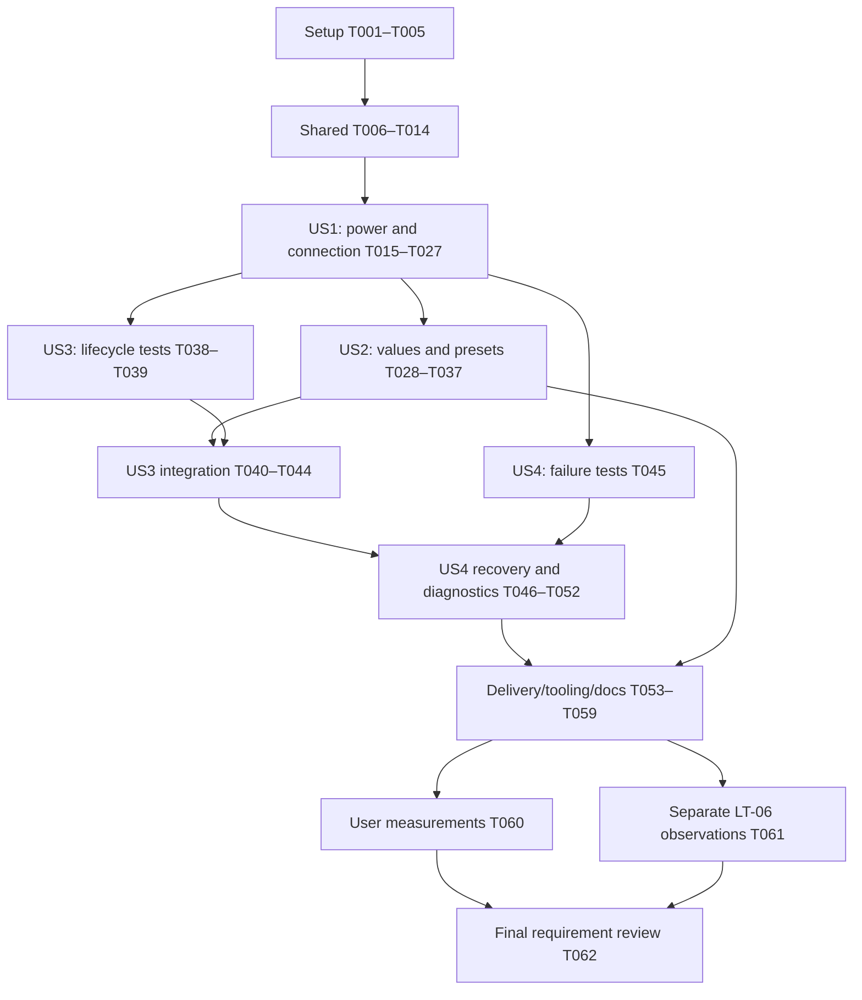

# Tasks: Плагин Stream Deck для управления MeRGBW

**Input**: Design documents from `specs/006-streamdeck-control-plugin/`.

**Prerequisites**: [plan.md](plan.md), [spec.md](spec.md), [research.md](research.md), [data-model.md](data-model.md), [HTTP contract](contracts/http-api.md), [plugin contract](contracts/plugin.md), [workflows](contracts/workflows.md), [quickstart.md](quickstart.md).

**Organization**: Setup → shared prerequisites → US1 (P1) → US2 (P1) → US3 (P2) → US4 (P2) → integration. Истории тестируются как отдельные пользовательские сценарии с уже настроенным общим подключением. Общие файлы интегрируются последовательно; независимые тесты и отдельные реализации допускают параллельное выполнение после указанных prerequisites.

**Tests**: Явно предусмотрены спецификацией, раздел Verification Evidence. Go — testing/httptest, Testify и существующие generated GoMock; Node — built-in test runner/node:assert/strict с injected facades и controlled clock. Tests перечислены перед соответствующей реализацией; обязательного red-first/TDD и numeric coverage threshold нет. Компилировать/запускать группу после появления её implementation.

**Status**: Все 62 задачи ожидают реализации. Создание этого файла не подтверждает исполнение кода, установку, пользовательские измерения или физические эффекты.

## Format: `[ID] [P?] [Story] Description`

- Один checkbox и уникальный sequential ID на задачу.
- [P] — независимые изменяемые файлы в доступной execution wave после prerequisites; это не указание запускать дополнительных агентов.
- [US1]–[US4] — история из spec.md; setup/shared/integration без story label.
- Указанные после задачи dependencies обязательны; checkpoint/evidence не подменяют реализацию.
- Manual задачи при отсутствии host/участников/лампы остаются unchecked и pending; остальные независимые задачи продолжаются.

## Path Conventions

Все пути внутри задач — от корня репозитория. Новый npm package: `streamdeck/`; runtime directory: `streamdeck/com.obalunenko.mergbw.sdPlugin/`. HTTP-каталог: `internal/bridge/`, Go *_test.go colocated. Workflow: `Taskfile.yml`, recorder `scripts/test_task_workflows.py`, paired user docs `README.md`/`README_RU.md`. Evidence: `specs/006-streamdeck-control-plugin/validation.md` и отдельный `hardware-verification.md`.

`controller.Link`, `bridge.Controller`, protocol/config types, BLE/native, root Go dependencies и Go tool modules не меняются. До Go-кода применяется modern-go-guidelines. Изменять Taskfile только в выделенной задаче T055; npm scripts до неё принадлежат package setup. Hardware не входит в default/CI и не запускается созданием tasks.md.

## Phase 1: Feature Preparation

**Purpose**: Создать только новую инфраструктуру плагина; существующий контроллер и Go tools не переинициализируются.

- [ ] T001 Создать `streamdeck/package.json` и `streamdeck/package-lock.json`: Node 24, @elgato/streamdeck 3.0.3, dev @elgato/cli 1.10.3, TypeScript/Rollup/@types/node 24 и совместимые Elgato lint tools с точными версиями/integrity; определить локальные scripts build/typecheck/test/lint/format:check/validate/package/link/watch по `specs/006-streamdeck-control-plugin/contracts/workflows.md`, без глобального npm install и изменений Go-модулей.
- [ ] T002 [P] Настроить strict backend/UI/test компиляцию в `streamdeck/tsconfig.json`, `streamdeck/tsconfig.ui.json`, `streamdeck/tsconfig.test.json`, `streamdeck/rollup.config.mjs`, а также Elgato ESLint/Prettier в `streamdeck/eslint.config.mjs` и `streamdeck/.editorconfig`; target ES2022, backend bin/plugin.js, UI ui/inspector.js, тесты .test-build без импорта запуска SDK. Prerequisites: T001.
- [ ] T003 [P] Добавить локальный SDPI Components v4 в `streamdeck/com.obalunenko.mergbw.sdPlugin/ui/vendor/sdpi-components.js`, его лицензию в `streamdeck/com.obalunenko.mergbw.sdPlugin/ui/vendor/LICENSE` и URL/SHA-256 в `streamdeck/com.obalunenko.mergbw.sdPlugin/ui/vendor/README.md`; зафиксировать содержимое, исключить runtime CDN. Prerequisites: T001.
- [ ] T004 [P] Создать общие metadata в `streamdeck/com.obalunenko.mergbw.sdPlugin/manifest.json`: UUID com.obalunenko.mergbw, Version 0.1.0.0, Name/Category MeRGBW, SDKVersion 3, Nodejs.Version 24, Software.MinimumVersion 7.1, только macOS >=13.5, CodePath bin/plugin.js, PropertyInspectorPath ui/index.html; действия будут добавлены вместе с реализацией в US1/US2. Prerequisites: T001.
- [ ] T005 [P] Настроить `.gitignore` и `streamdeck/com.obalunenko.mergbw.sdPlugin/.sdignore`: исключить node_modules, .test-build, generated bundles, logs и root dist из Git, а secrets/config/URLs/tests/source maps/dev fixtures из installer, сохранив source assets и vendor license. Prerequisites: T001.

## Phase 2: Shared Prerequisites

**Purpose**: Общие настройки, безопасный транспортный контракт и read-only каталог необходимы нескольким историям. Все задачи этой фазы завершаются до интеграции историй.

- [ ] T006 Определить типы и runtime validation общих настроек в `streamdeck/src/validation.ts`: schemaVersion — «integer, exactly 1», connection — «null or Connection», language — «en or ru» с default en; Connection.port — «integer 1024–65535, default 18765», accessToken — «строка /^[A-Za-z0-9_-]{24,128}$/»; host не сохранять, corrupt/unknown version не сбрасывать автоматически. Prerequisites: T002.
- [ ] T007 [P] Добавить контрактные Go-тесты в `internal/bridge/presets_test.go` на GET /<token>/presets, sorted/custom/duplicate/renamed labels, пустой [], отсутствие private fields, Host/token/query/ForceQuery/RawPath/body/chunked/method rejection, HEAD без body и headers; Testify и существующий strict generated MockController должны запрещать Execute и Connected, без native imports. Prerequisites: T001.
- [ ] T008 [P] Создать общие RU/EN dictionaries и fallback в `streamdeck/src/i18n.ts`: подписи подключения, пяти действий, busy/sent/error/unknown и recovery; явный language selector «en or ru», без зависимости от автоматического ru.json или сетевой загрузки. Prerequisites: T002.
- [ ] T009 Реализовать безопасную основу диагностики в `streamdeck/src/diagnostics.ts`: allowlist event/actionKind/outcome/errorCategory/durationMs/requestId/operationId; «Request ID принимается только как короткая decimal строка.»; редактировать текущий и in-flight прежний секреты, не сериализовать URL/settings/raw errors/PI events/labels. Prerequisites: T006.
- [ ] T010 Реализовать SDK-backed storage в `streamdeck/src/settings.ts`: global connection/language отдельно от action assignments, сериализованные saves, пустой replacementToken сохраняет прежний токен, failed save сохраняет active snapshot, language-only save не меняет connection; connectionRevision увеличивается при успешной смене, cache/check инвалидируются, действующие операции сохраняют снимок; allowlist action writes, без исполнения команд. Prerequisites: T006.
- [ ] T011 Применить modern-go-guidelines перед Go-изменениями и добавить каталог в `internal/bridge/http.go` и `internal/bridge/presets.go`: точный путь после shared Host/URL guards и до legacy method dispatch, GET-only, 405 Allow: GET для иных методов, body guard и constant-time auth до данных; вернуть sorted {id,label} и physical_state_verified:false через respond, без Execute/Connected; legacy маршруты и интерфейсы не менять. Prerequisites: T007.
- [ ] T012 Создать Node test harness в `streamdeck/tests/helpers.ts` с SDK/storage/logger facade, controlled monotonic clock и temporary IPv4 HTTP fixture; тесты не импортируют `streamdeck/src/plugin.ts`, не подключаются к 18765, не читают реальные settings и не запускают Bluetooth. Prerequisites: T002, T006.
- [ ] T013 Создать runtime OperationRecord и guard в `streamdeck/src/operation-store.ts`: operationId — «generated opaque local ID», context/actionKind — «SDK target and one of five actions», settingsRevision/connectionRevision — «Immutable dispatch versions», snapshot — «canonical route plus connection; secret stays private in memory», startedAt/deadlineAt — «monotonic; deadline = activation +45s», status — «pending/sent/rejected/unknown», errorCategory — «optional local validation/service/auth/parameter/preset/backend/protocol/timeout», requestId — «optional decimal header, length <=32», durationMs — «nonnegative local measurement»; занятость ставится до await, не является физическим состоянием. Prerequisites: T006, T009.
- [ ] T014 Определить проверяемый PI envelope и безопасные DTO в `streamdeck/src/inspector-messages.ts`: «Versioned envelope v=1, sessionId, requestId, type и allowlisted payload.»; context брать из SDK event, ограничить типы восемью операциями из `specs/006-streamdeck-control-plugin/contracts/plugin.md`; replies только соответствующей session/request, connection summary configured/port/hasToken без секрета, произвольного URL или текста server error. Prerequisites: T006, T010, T013.

## Phase 3: User Story 1 — Подключить плагин и добавить управление питанием (Priority: P1)

**Goal**: Одноразовый импорт подключения, безопасная проверка и рабочие ON/OFF без Website-ссылок на каждой кнопке.

**Independent Test**: С имитатором установить локальный MVP, импортировать одну ссылку, раздельно увидеть service/auth/Bluetooth, выполнить ровно одну команду на press/release ON/OFF и восстановить назначения после рестарта.

### Behavioral Verification and Implementation

- [ ] T015 [P] [US1] Добавить boundary-тесты клиента/импорта в `streamdeck/tests/bridge-client.test.ts`: canonical IPv4/no proxy/redirect/retry, точные GET health/catalog и POST без body/query, match action/sent/physical_state_verified, 64 KiB command/health и 1 MiB catalog caps, отсутствие side effects при import; только локальные fixtures. Prerequisites: T012.
- [ ] T016 [P] [US1] Добавить tests глобального storage в `streamdeck/tests/settings.test.ts`: blank/new/corrupt/unknown schema, границы port/token, сохранение после restart, offline save, blank replacement, language-only update, failure/concurrent saves и отсутствие connection/token/URL в persisted action settings. Prerequisites: T012, T010.
- [ ] T017 [P] [US1] Добавить PI-контрактные tests в `streamdeck/tests/inspector-messages.test.ts`: version/type/context/session/request checks, secret-free snapshots и отсутствие команд при inspector.get/import/save/check/close; health не подтверждает token, ответы устаревшей session отбрасываются. Prerequisites: T012, T014.
- [ ] T018 [US1] Реализовать parser существующих ссылок в `streamdeck/src/validation.ts`: один trimmed HTTP URL, literal localhost/127.0.0.1, explicit port/token и только on/off/color/brightness/preset routes; проверять raw syntax до URL normalization, отклонять credentials/HTTPS/IPv6/alternative IP/escapes/backslash/traversal/query даже ?/fragment/trailing slash/multiline; извлекать только connection, не выполнять и не сохранять исходную команду. Prerequisites: T015, T006.
- [ ] T019 [US1] Реализовать `streamdeck/src/bridge-client.ts` на node:http: fixed 127.0.0.1/family 4, GET read-only и POST Content-Length:0, полный command deadline от activation +45s и 5s для каждого read-only, caps/schema checks, destroy/cleanup/finalize-once, ноль retries/redirects; только валидный 200 sent:true с exact action и physical_state_verified:false даёт sent, небезопасный/потерянный ответ не даёт успеха. Prerequisites: T015, T018, T013.
- [ ] T020 [US1] Реализовать connection.check/import/save/get/close в `streamdeck/src/inspector-messages.ts`: отдельные service «unknown/available/unavailable/incompatible», authorization «unknown/verified/denied», bluetooth «unknown/connected/disconnected», catalog «unknown/available/unsupported/error» с checkedAt/safe message key/request ID; health и catalog независимо, legacy catalog 400/404/405 = update-required/auth unknown без блокировки совместимых кнопок, revision/generation guards и отсутствие ламповых команд. Prerequisites: T017, T019, T011, T010.
- [ ] T021 [US1] Создать `streamdeck/src/actions/base-action.ts`, `streamdeck/src/actions/power-on.ts`, `streamdeck/src/actions/power-off.ts`: power settings «schemaVersion:1», «no parameter»; один POST только на onKeyDown, onKeyUp/appear/settings/PI без отправки, synchronous per-context busy, immutable dispatch snapshot и проверка record перед completion, explicit local validation до сети. Prerequisites: T019, T010, T013.
- [ ] T022 [US1] Реализовать power feedback в `streamdeck/src/feedback.ts`: default command title/image, brief showAlert attention при старте и busy repeat, PI «Выполняется», showOk только на validated sent; safe error/unknown и следующий шаг, никогда lamp-state claim и никаких изменений пользовательских title/icon settings. Prerequisites: T021, T008.
- [ ] T023 [US1] Создать общий PI в `streamdeck/com.obalunenko.mergbw.sdPlugin/ui/index.html`, `streamdeck/com.obalunenko.mergbw.sdPlugin/ui/inspector.css`, `streamdeck/src/ui/inspector.ts`: одноразовый import, port/password replacement, Save/Check и RU/EN, три независимых статуса; secret fields без setting binding/getGlobalSettings, очищать после save, подписываться только на sanitized replies, session-scoped requests, никаких direct HTTP/test-command кнопок. Prerequisites: T020, T003, T008, T022.
- [ ] T024 [US1] Создать `streamdeck/src/plugin.ts`, зарегистрировать два power действия для MVP в `streamdeck/com.obalunenko.mergbw.sdPlugin/manifest.json` и добавить assets `streamdeck/com.obalunenko.mergbw.sdPlugin/imgs/on.png`, `streamdeck/com.obalunenko.mergbw.sdPlugin/imgs/off.png`, `streamdeck/com.obalunenko.mergbw.sdPlugin/imgs/plugin.png`; stable UUID suffixes on/off, Keypad/one state/no toggle/SupportedInMultiActions:false; logger INFO до connect во всех режимах, тесты bootstrap не запускают. Prerequisites: T004, T021, T022, T023, T009.
- [ ] T025 [US1] Создать normal-mode fixture в `streamdeck/scripts/mock-bridge.mjs`: только 127.0.0.1:18766 и public synthetic token из `specs/006-streamdeck-control-plugin/contracts/workflows.md`, health Bluetooth false, startup --catalog baseline (default)/renamed/deleted/duplicate-labels/empty с точными id/labels по контракту; неизвестный вариант завершает startup с ошибкой. Preset command проверяет id активного каталога, missing id даёт 400 без sent; счётчик всех полученных command requests, включая rejected, с type/parameter/outcome, без токена/полных URL; health/catalog не увеличивают счётчик, restart обнуляет его. Не читать реальные файлы и не импортировать Go/native. В `streamdeck/tests/mock-bridge.test.ts` проверить варианты/envelope/missing id/counter через injected fixture handler без автозапуска CLI/listener, использовать существующий harness. Prerequisites: T019, T011, T012.
- [ ] T026 [US1] Добавить end-to-end power behavior tests через SDK facade в `streamdeck/tests/power-actions.test.ts`: press/release ровно один POST, busy повтор не добавляет запрос, независимые контексты не блокируются, check/import/appear/restart не отправляют, ответы не объявляют физическое ON/OFF; прогнать US1 tests вместе с `internal/bridge/presets_test.go`. Prerequisites: T024, T025, T012.
- [ ] T027 [US1] Выполнить отдельный раздел 0 «Internal two-action MVP (T027)» в `specs/006-streamdeck-control-plugin/quickstart.md`: локальные npm ci/lint/format:check/typecheck/test/build/validate/package из `streamdeck/package.json`, без plugin:* T055 или five-action checker T053; проверить установку, импорт/check без команд, по одному ON/OFF на press/release и сохранение после restart на --catalog baseline. Записать versions/счётчики/наблюдения в `specs/006-streamdeck-control-plugin/validation.md`; US2–US4, полный package gate, пользовательские измерения и LT-06 не считать проверенными. Недоступную host-проверку оставить pending. Prerequisites: T026.

**Checkpoint**: С имитатором установить локальный MVP, импортировать одну ссылку, раздельно увидеть service/auth/Bluetooth, выполнить ровно одну команду на press/release ON/OFF и восстановить назначения после рестарта. Результаты истории фиксируются отдельно от аппаратной проверки; недоступные измерения остаются pending.

## Phase 4: User Story 2 — Настроить цвет, яркость и пресеты (Priority: P1)

**Goal**: Добавить остальные три действия, визуальную настройку и текущий каталог пользовательских пресетов.

**Independent Test**: При уже заданном подключении выбрать RGB, целые проценты 0/100 и пользовательский пресет; проверить команды, rename/delete/duplicate labels и refresh без подмены id.

### Behavioral Verification and Implementation

- [ ] T028 [P] [US2] Добавить contract tests в `streamdeck/tests/action-values.test.ts` на color picker/HEX normalization, defaults только для empty/new settings, проценты 0/100 и отрицательные/fractional/string/NaN значения, valid/unset/invalid presetId и неподдерживаемую schema; повреждённые настройки не отправляют запрос. Prerequisites: T012, T021.
- [ ] T029 [P] [US2] Добавить catalog lifecycle tests в `streamdeck/tests/preset-catalog.test.ts`: custom/rename/duplicate labels/empty/delete, stale refresh и connection/session change, runtime schema/oversize rejection, old-controller catalog 400/404/405 и отсутствие подмены сохранённого id либо отключения power/color/brightness. Prerequisites: T012, T020.
- [ ] T030 [US2] Реализовать action validators/defaults в `streamdeck/src/validation.ts`: color «schemaVersion:1, rgb:string», default FF5000, «uppercase шестизначным hex без #» с одним optional # в UI; brightness «schemaVersion:1, percent:integer», default 50 и «число integer 0–100; строки, пустое значение, NaN, дроби не приводятся молча»; preset «schemaVersion:1, presetId?:string», default unset и «/^[a-z0-9_-]{1,40}$/»; unknown/corrupt не заменять defaults. Prerequisites: T028, T006, T018.
- [ ] T031 [US2] Реализовать presets.refresh и runtime cache в `streamdeck/src/inspector-messages.ts`: connectionRevision/requestGeneration «integer», status «idle/loading/available/unavailable/unauthorized», entries «array of {id,label}» и «unique id; sorted by id; label nonblank single line», refreshedAt «monotonic timestamp»; safe text labels с очисткой секретов/control chars, duplicate labels показывать с id, stale replies не применять, deleted known id блокировать, valid saved id при unavailable catalog можно явно отправить со статусом непроверенного списка. Prerequisites: T029, T030, T020.
- [ ] T032 [P] [US2] Создать действие в `streamdeck/src/actions/color.ts` на общем base: canonical color/<UPPERCASE-RGB>, explicit validated parameter, одна команда и существующее power-on поведение контроллера, без собственного BLE или дополнительного on POST. Prerequisites: T030, T021.
- [ ] T033 [P] [US2] Создать действие в `streamdeck/src/actions/brightness.ts` на общем base: canonical brightness/<integer>, включительно 0 и 100, без приведения invalid input, без отдельной команды on и без изменения протокола. Prerequisites: T030, T021.
- [ ] T034 [US2] Создать действие в `streamdeck/src/actions/preset.ts`: отправлять preset/<stable-id>, known missing/unset блокировать с подсказкой, unavailable catalog не заменяет сохранённый id, rename label не меняет назначение; backend rejection предлагает refresh/reselection. Prerequisites: T031, T030, T021.
- [ ] T035 [US2] Расширить `streamdeck/src/ui/inspector.ts`, `streamdeck/com.obalunenko.mergbw.sdPlugin/ui/index.html` и `streamdeck/src/feedback.ts`: color picker+HEX, slider+integer input, preset select/refresh с состояниями списка и duplicate labels (id); default color/percent/label на кнопке, явно пояснить power-on для трёх действий; assignment.save только allowlisted schema текущего UUID. Prerequisites: T032, T033, T034, T023.
- [ ] T036 [US2] Зарегистрировать color/brightness/preset в `streamdeck/src/plugin.ts` и `streamdeck/com.obalunenko.mergbw.sdPlugin/manifest.json`; добавить `streamdeck/com.obalunenko.mergbw.sdPlugin/imgs/color.png`, `streamdeck/com.obalunenko.mergbw.sdPlugin/imgs/brightness.png`, `streamdeck/com.obalunenko.mergbw.sdPlugin/imgs/preset.png`; все пять stable UUID, Keypad/one state/no toggle/no Multi Action и одинаковый PI. Prerequisites: T035, T024.
- [ ] T037 [US2] Проверить US2 автоматические scenarios в `streamdeck/tests/action-values.test.ts`, `streamdeck/tests/preset-catalog.test.ts` и fixture coverage в `streamdeck/tests/mock-bridge.test.ts`, затем picker/percent/preset/refresh в host по разделу 2 `specs/006-streamdeck-control-plugin/quickstart.md`: restart fixture с --catalog baseline → renamed → deleted → duplicate-labels → empty → baseline, Refresh после каждого запуска; до T055 использовать direct node команду из руководства. Проверить стабильный sunset id при rename, блокировку missing/empty без подмены, различимость duplicate labels по id и восстановление. Записать exact values/id/labels/счётчики внутри каждого запуска, отсутствие команд от refresh и pending для непроверенного UI в `specs/006-streamdeck-control-plugin/validation.md`. Prerequisites: T036, T025.

**Checkpoint**: При уже заданном подключении выбрать RGB, целые проценты 0/100 и пользовательский пресет; проверить команды, rename/delete/duplicate labels и refresh без подмены id. Результаты истории фиксируются отдельно от аппаратной проверки; недоступные измерения остаются pending.

## Phase 5: User Story 3 — Добавлять независимые кнопки и сохранять раскладку (Priority: P2)

**Goal**: Изолировать копии/профили, обновлять общее подключение без потери назначений и сохранять custom appearance/секреты.

**Independent Test**: Изменить копию, переключить профиль и перезапустить хост трижды; проверить 10 назначений всех видов, custom title/icon, secret-free profile и корректное состояние после импорта в чистую установку.

### Behavioral Verification and Implementation

- [ ] T038 [P] [US3] Добавить tests copy/edit/export/import в `streamdeck/tests/assignment-lifecycle.test.ts`: allowlisted action settings без token/URL, stable presetId, независимые копии, corrupted/unknown schema не сбрасывается, чистая установка без global connection unconfigured и существующее общее подключение переиспользуется. Prerequisites: T012, T030, T010.
- [ ] T039 [P] [US3] Добавить interleaving tests в `streamdeck/tests/lifecycle.test.ts`: port/token/assignment mutation при pending, hide/reappear/delete, смена PI session/profile, late response после нового connection и deadline, cleanup невидимых завершённых записей; ни stale success, ни replay, ни снятие чужого busy недопустимы. Prerequisites: T012, T021, T014.
- [ ] T040 [US3] Завершить SDK settings lifecycle в `streamdeck/src/settings.ts`: привязать persisted allowlists всех пяти UUID к per-context settingsRevision, общее connectionRevision/serialized saves ко всем кнопкам, сохранить копии/custom metadata и не допускать command side effects от settings notifications; импорт профиля не переносит token и не запускает действие. Prerequisites: T038, T010, T036.
- [ ] T041 [US3] Интегрировать disappear/reappear/delete и revisions в `streamdeck/src/operation-store.ts` и `streamdeck/src/actions/base-action.ts`: runtime-only контекст, guard до terminal/deadline, exact operationId+revisions до repaint, old snapshot не перенаправляется, поздние network events не финализируют дважды/не снимают новый guard; cleanup terminal invisible records, без восстановления команд после process restart. Prerequisites: T039, T040, T013.
- [ ] T042 [US3] Завершить restore/appearance lifecycle в `streamdeck/src/feedback.ts`: сохранять host overrides, возвращать default/custom оформление после temporary feedback, не отображать старый результат новому назначению; pending attention виден независимо от supplemental runtime image, без записи пользовательских title/icon settings. Prerequisites: T041, T022.
- [ ] T043 [US3] Синхронизировать sanitized snapshots и current-session subscriptions в `streamdeck/src/inspector-messages.ts` и `streamdeck/src/ui/inspector.ts`: reopening показывает текущий pending/последнюю safe ошибку, смена connection исключает старый catalog/check, close удаляет session subscription без отмены уже переданного действия, global payloads не попадают в DOM/logs. Prerequisites: T040, T041, T035.
- [ ] T044 [US3] Выполнить copy/custom/profile/export/import и три рестарта для 10 назначений пяти видов по `specs/006-streamdeck-control-plugin/quickstart.md`; проверить экспорт на отсутствие synthetic token/полной ссылки, импорт в чистый global storage и однократную смену подключения; записать measured/pass/fail/pending в `specs/006-streamdeck-control-plugin/validation.md` без реальных credentials. Prerequisites: T042, T043.

**Checkpoint**: Изменить копию, переключить профиль и перезапустить хост трижды; проверить 10 назначений всех видов, custom title/icon, secret-free profile и корректное состояние после импорта в чистую установку. Результаты истории фиксируются отдельно от аппаратной проверки; недоступные измерения остаются pending.

## Phase 6: User Story 4 — Понимать ошибки и восстанавливать управление (Priority: P2)

**Goal**: Дать различимые безопасные причины отказа и неизвестного исхода, диагностику и восстановление без автоматического повтора.

**Independent Test**: Симулировать offline/auth/Bluetooth failure/503/504/timeout/malformed/echo; проверить busy suppression, неизвестный возможный поздний эффект, сохранённые настройки и отсутствие секретов в UI/logs.

### Behavioral Verification and Implementation

- [ ] T045 [P] [US4] Добавить failure-contract tests в `streamdeck/tests/failures.test.ts`: offline до отправки, auth/parameter/preset/route rejection, 503 как возможный partial/unknown, 504, 3xx без follow, bad Content-Type/schema/action, truncated/oversized body, transport loss после dispatch, total 45s включая body и 5s read-only; статусы не извлекать из русских error strings, после каждого исхода ноль auto retries. Prerequisites: T012, T019, T021.
- [ ] T046 [P] [US4] Добавить redaction/diagnostic tests в `streamdeck/tests/diagnostics.test.ts` и Go logging coverage в `internal/bridge/logging_test.go`: error echoes token/full URL, in-flight old token после rotation, злонамеренные labels/control chars/request IDs, INFO до connect, allowlist duration/request ID; catalog не создаёт command.sent и не пишет private inputs, без новых handwritten Go doubles. Prerequisites: T012, T009, T043.
- [ ] T047 [US4] Завершить outcome/category mapping в `streamdeck/src/bridge-client.ts` и `streamdeck/src/operation-store.ts`: definite rejection отдельно от backend/timeout/protocol unknown, requestId «optional decimal header, length <=32», duration «nonnegative local measurement»; уничтожать ожидание и финализировать ровно раз на deadline, следующий manual press разрешён без обещания native cancel. Prerequisites: T045, T041.
- [ ] T048 [US4] Завершить error/recovery presentation в `streamdeck/src/i18n.ts`, `streamdeck/src/feedback.ts`, `streamdeck/src/ui/inspector.ts`: «unconfigured», «ready», «pending», «sent», «error», «unknown» по модели, safe last explanation до следующей операции/изменения, static следующий шаг для каждой категории, possible late execution при unknown; раздельные service/auth/Bluetooth, showOk только sent, no physical-state fields. Prerequisites: T047, T008, T043.
- [ ] T049 [US4] Подключить safe events plugin.ready/connection.checked/presets.loaded-or-failed/action.started-or-sent-or-rejected-or-unknown в `streamdeck/src/diagnostics.ts`, `streamdeck/src/plugin.ts`, `streamdeck/src/inspector-messages.ts` и `streamdeck/src/actions/base-action.ts`; не передавать logger сырые exceptions/settings/events/response/URL даже при failure, не включать transport tracing. Prerequisites: T046, T048.
- [ ] T050 [US4] Расширить `streamdeck/scripts/mock-bridge.mjs` режимами auth-denied, legacy, backend-error, timeout, malformed, echo-secret и флагом --bluetooth-connected по `specs/006-streamdeck-control-plugin/contracts/workflows.md`; сохранить независимый --catalog из T025, failure mode определяет ответы, normal использует выбранный snapshot. Echo только public fixture token, timeout >45s, legacy catalog 400 при рабочих других actions; явно simulator, без real settings/BLE и replay. Расширить `streamdeck/tests/mock-bridge.test.ts` проверками сочетаний catalog/mode/Bluetooth. Prerequisites: T025.
- [ ] T051 [US4] Добавить серию 100 отдельных активаций и concurrency/deadline recovery в `streamdeck/tests/activation-series.test.ts`: exact one command/values, repeat pending не добавляет запрос, other contexts independent, late finalize/new operation guard безопасны, callbacks не меняют новую session/assignment; controlled clock вместо реального 45s ожидания, RU/EN dictionary parity и no secret leakage во всех failure cases. Prerequisites: T049, T036, T050.
- [ ] T052 [US4] Проверить все failure/recovery fixture modes, custom attention и last explanation по `specs/006-streamdeck-control-plugin/quickstart.md`, просмотреть безопасные plugin logs и повторить normal mode без reinstall; записать исходы/счётчик/no replay/token absence в `specs/006-streamdeck-control-plugin/validation.md`, не объявлять unknown lamp state проверенным. Prerequisites: T051.

**Checkpoint**: Симулировать offline/auth/Bluetooth failure/503/504/timeout/malformed/echo; проверить busy suppression, неизвестный возможный поздний эффект, сохранённые настройки и отсутствие секретов в UI/logs. Результаты истории фиксируются отдельно от аппаратной проверки; недоступные измерения остаются pending.

## Phase 7: Integration and Documentation

**Purpose**: Завершить воспроизводимую поставку, согласованные инструкции и раздельные автоматические/host/hardware доказательства.

- [ ] T053 [P] Создать `streamdeck/scripts/check-package.mjs` и его tests `streamdeck/tests/package.test.ts`: ровно пять UUID, manifest paths/minima, runtime bundles/assets/vendor SHA/license и отсутствие remote assets, logs/secrets/config/generated URLs/source maps/tests/dev fixtures; проверить `.sdignore` против pack report/installer entries, без реальных секретов в аргументах. Prerequisites: T036, T051, T005, T003.
- [ ] T054 [P] Расширить recorder в `scripts/test_task_workflows.py` fake npm/Node executables: plugin tasks имеют dir streamdeck, точный порядок check/package, CLI_ARGS quoting, propagation failures, отсутствие implicit install/link/watch/mock/native/hardware/Spec Kit; прежние Go workflows не меняются. Prerequisites: T051.
- [ ] T055 Добавить все plugin:* задачи в `Taskfile.yml` и финальные npm scripts в `streamdeck/package.json` по `specs/006-streamdeck-control-plugin/contracts/workflows.md`: deps=npm ci, ordered check, package после check в root dist с --no-update-check, explicit link/watch/mock; сохранить make tools и legacy task check, запустить recorder и не маскировать exit codes. Prerequisites: T053, T054.
- [ ] T056 [P] Согласованно обновить `README.md` и `README_RU.md`: prerequisites/локальная установка, подготовленный sunset, одноразовый импорт, пять actions/RU-EN/preset refresh, attention vs sent vs unknown/late effect, journal location/no TRACE, старые Website кнопки и локальные plugin:* commands; без реальных identity/token/URL. Prerequisites: T055, T048.
- [ ] T057 [P] Добавить `.github/workflows/streamdeck.yml`: Ubuntu/Node 24, repository Task через tools/task Go version и make tools, затем plugin:deps/plugin:check; GitHub Actions pin на проверенные SHA, никакого installed Stream Deck/sunset/Bluetooth/hardware/Spec Kit; существующий `.github/workflows/ci.yml` оставить с текущими Go/macOS build правилами. Prerequisites: T055.
- [ ] T058 Выполнить gofmt для изменённых `internal/bridge/http.go`, `internal/bridge/presets.go`, `internal/bridge/presets_test.go`, `internal/bridge/logging_test.go` и при изменении `internal/bridge/http_test.go`; запустить task test:core/test:race/vet/build, plugin:check, workflows:test и plugin:package, проверить installer entries, записать версии/результаты в `specs/006-streamdeck-control-plugin/validation.md`; mocks:generate только при изменении generator inputs. Prerequisites: T055, T056, T057.
- [ ] T059 В Linux CI/эквивалентной среде выполнить существующий task check и новый Node workflow из `.github/workflows/streamdeck.yml`, сохранив hardware-free границу; записать ссылки на run и статус в `specs/006-streamdeck-control-plugin/validation.md`. Недоступную Linux-проверку оставить pending, не подменять macOS build. Prerequisites: T058.
- [ ] T060 Провести измерения SC-001/002/005 из `specs/006-streamdeck-control-plugin/quickstart.md`: 5 участников, >=4/5 укладываются в 5 минут для setup/power и 60 секунд на color/brightness/preset, 100 samples с 95% feedback <=300ms/1s; переиспользовать годные SC-003/004/006/007 evidence, результаты/непроведённые измерения раздельно внести в `specs/006-streamdeck-control-plugin/validation.md`, не отмечать задачу завершённой без требуемых измерений. Prerequisites: T044, T052, T058.
- [ ] T061 Отдельно локально проверить реальную LT-06 из Stream Deck: on/off, RGB, brightness 25 и 75, preset sunset, совместимость старых кнопок; записать expected/observed/pending и platform/version без credentials в `specs/006-streamdeck-control-plugin/hardware-verification.md`, защищённые device details только в локальном `.hardware-verification/`. Existing task test:hardware — только отдельная опция, не CI/default; без лампы задача остаётся невыполненной, sent/build не закрывают physical evidence. Prerequisites: T058, T037, T052.
- [ ] T062 Сверить все FR-001–FR-017 и SC-001–SC-008 с `specs/006-streamdeck-control-plugin/spec.md`, `specs/006-streamdeck-control-plugin/quickstart.md`, `specs/006-streamdeck-control-plugin/validation.md` и `specs/006-streamdeck-control-plugin/hardware-verification.md`; исправить найденные расхождения кода/документации, явно сохранить непроверенные пункты и не заявлять полную приёмку при оставшемся pending. Prerequisites: T056, T058, T059, T060, T061.

## Dependencies and Execution Order

### Story graph

Диаграмма показывает интеграцию историй, а не запрещает раннее написание независимых тестов. Точные prerequisites каждой задачи — источник порядка. Phase 2 целиком является общим prerequisite для story integration; Phase 7 integration начинается после code/automated portions историй. Manual T027/T037/T044/T052 не блокируют не зависящие от них задачи, но нужны соответствующей приёмке.

| Chain / gate | Required ordering |
| --- | --- |
| Shared catalog | T007 → T011 → T020; auth-check не использует lamp command |
| Shared storage/messages | T006 → T010 → T014 → T017/T020/T023 |
| Minimal working power | T015 → T018 → T019 → T021 → T022/T023 → T024 → T026 → T027 |
| Values/presets | T028/T029 → T030/T031 → T032/T033/T034 → T035 → T036 → T037 |
| Lifecycle | T038/T039 → T040 → T041 → T042/T043 → T044 |
| Error recovery | T045/T046 → T047/T048/T049, T050 → T051 → T052 |
| Full delivery | T053/T054 → T055 → T056/T057 → T058 → T059 |
| Final acceptance | T058 плюс story evidence → T060/T061; все требуемые наблюдения → T062 |

Нельзя одновременно менять `streamdeck/src/validation.ts` (T006/T018/T030), `settings.ts` (T010/T040), `inspector-messages.ts` (T014/T020/T031/T043/T049), `feedback.ts` (T022/T035/T042/T048), `ui/inspector.ts` (T023/T035/T043/T048), `plugin.ts` (T024/T036/T049), manifest или общий validation.md. Авторство отдельных tests не разрешает конфликтующие правки helpers. Новых изменений interface callers/GoMock не требуется; если необходимость возникнет, сначала пересмотреть design и явно согласовать зависимые изменения.

## Parallel Execution Examples

Примеры применяются только после названных dependencies и phase gates. Это возможности планирования, не инструкция запуска агентов.

| Story / stage | Parallel tasks | Why safe |
| --- | --- | --- |
| US1 after shared prerequisites | T015, T016, T017 | Отдельные client/storage/PI test files, стабильный harness |
| US2 after US1 code | T028, T029 | Value and catalog contract tests в разных файлах |
| US2 after T030 and base T021 | T032, T033 | Color и brightness action files независимы; общие registration/UI позже |
| US3 after нужных US1/US2 schemas | T038, T039 | Assignment/export и operation lifecycle test files раздельны |
| US4 after T043 | T045, T046 | Failure tests, diagnostics tests и Go logging file не пересекаются |
| Setup after T001 | T002, T003, T004, T005 | Build config, vendor, manifest и ignore paths различны |
| Shared foundation | T007 alongside T006/T008 | Catalog Go tests отделены от TypeScript schema/dictionaries |
| Delivery after story code | T053, T054 | Package-content check и Task workflow recorder раздельны |
| Delivery after T055 | T056, T057 | Paired README и отдельный CI workflow |

[P] отмечена 21 задача. Не все 21 одновременно доступны: prerequisites и shared-file serial integration сохраняются.

## Implementation Strategy

### MVP first

1. Завершить T001–T014.
2. Реализовать US1 T015–T026, затем проверить внутренний двухдействийный MVP T027 на имитаторе/host. Авторизация уже использует read-only каталог, secret handling и bounded/no-retry transport не откладываются.
3. Это минимальный пользовательский срез для проверки удобства, не окончательная поставка полной функции: FR-001 требует пять действий, package checker и полная приёмка приходят позже.
4. Отсутствие host evidence не останавливает независимую реализацию US2–US4; не записывать pending как выполненный MVP test.

### Incremental delivery

US2 добавляет три действия и актуальный выбор пресетов; US3 завершает copy/profile/revision isolation; US4 даёт полноценные безопасные причины отказа и восстановление. После них T053–T059 вводят полный package/check/CI/docs gate. T060/T061 собирают разные виды evidence; T062 закрывает только реально подтверждённую приёмку.

Проверки выполняются по затронутому поведению. Go core/race на macOS, Linux task check, отдельные plugin checks без real SDK connect. Spec Kit инструменты не меняются, их тесты не добавляются в CI/task check. Установка/экспорт и физические наблюдения не подменяются компиляцией.

## Requirement Coverage

| Requirement | Implement / verify tasks |
| --- | --- |
| FR-001 | T004, T024, T032–T036, T053, T055, T058 |
| FR-002 | T017, T023, T035, T043 |
| FR-003 | T006, T010, T016, T018, T020, T023 |
| FR-004 | T015, T018, T019, T045 |
| FR-005 | T007, T011, T017, T020, T023 |
| FR-006 | T010, T016, T038–T044 |
| FR-007 | T028, T030, T032, T033, T035 |
| FR-008 | T029, T031, T034, T035, T037 |
| FR-009 | T007, T011, T020, T029, T031 |
| FR-010 | T013, T021, T022, T026, T039, T041, T045, T051, T060 |
| FR-011 | T008, T022, T042, T047, T048, T052 |
| FR-012 | T019, T039, T045, T047, T048, T050–T052 |
| FR-013 | T005, T009, T010, T014, T016, T023, T038, T043, T046, T049, T053 |
| FR-014 | T022, T035, T042, T044, T060 |
| FR-015 | T007, T011, T019, T021, T058, T059, T061 |
| FR-016 | T009, T046, T049, T052, T056 |
| FR-017 | T008, T023, T048, T051, T056 |
| SC-001 | T027, T056, T060 |
| SC-002 | T037, T056, T060 |
| SC-003 | T026, T051 |
| SC-004 | T038–T044 |
| SC-005 | T022, T045, T051, T060 |
| SC-006 | T020, T045–T052 |
| SC-007 | T038, T044, T046, T049, T052, T053 |
| SC-008 | T007, T011, T058, T059, T061, T062 |

## Task Summary and Completion Rules

| Group | Count |
| --- | --- |
| Setup | 5 |
| Shared prerequisites | 9 |
| US1 | 13 |
| US2 | 10 |
| US3 | 7 |
| US4 | 8 |
| Integration/documentation | 10 |
| **Total** | **62** |

Новые файлы validation.md и hardware-verification.md создаются задачами evidence; реальные идентичности/секреты в них не записываются. Manual/hardware задачи остаются unchecked без фактической проверки и могут иметь pending record. Проверка формата и требований задач не означает, что реализация выполнена.
