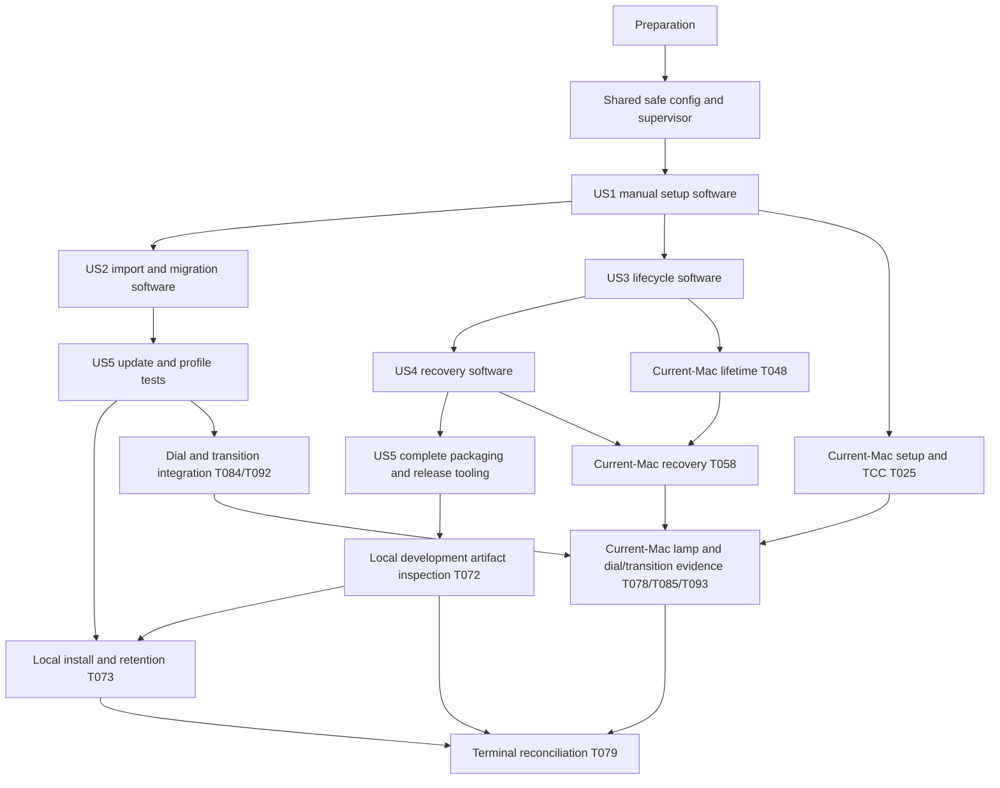

# Tasks: Самостоятельный плагин MeRGBW со встроенным контроллером

**Input**: Design documents from `specs/007-bundled-plugin-controller/`.
**Prerequisites**: [plan.md](plan.md), [spec.md](spec.md), [research.md](research.md), [data-model.md](data-model.md), [runtime](contracts/managed-runtime.md), [configuration/UI](contracts/configuration-ui.md), [distribution](contracts/distribution.md), [transitions](contracts/transitions.md), [quickstart.md](quickstart.md), constitution v1.2.0.
**Scope update, 2026-10-24**: Personal development and local installation are the acceptance target. Developer ID, notarization, stapling, downloading an installer and quarantine testing are outside the required scope. Existing local ad-hoc helper signing stays credential-free. Universal packaging remains available; current-Mac linked fixtures are accepted for local checks. Preserve earlier results as historical evidence, not new observations.

**Branch**: `develop`. **Status**: Implementation in progress; 2026-10-24 task refresh preserves recorded finishes and open acceptance gates.

**Organization**: Seven independently verifiable user stories after shared safety prerequisites, followed by final cross-cutting acceptance. Preserve the original five-story implementation order and the later P1 dial/transition increments: their recorded dependencies include the earlier P2 recovery/package software, so priority does not override prerequisites. Stable IDs and existing checkmarks are retained; tasks are regrouped without renumbering history. Reuse existing packages/tools; no project reinitialization. Behavioral tests are explicitly required by FR-028, SC-011/012 and spec acceptance; no strict TDD or coverage percentage is introduced.

## Format: `[ID] [P?] [Story] Description`

- IDs preserve append order; `Depends:` lists actual prerequisites and determines execution order, including later IDs from appended increments. Keep the graph acyclic; T079 is the terminal reconciliation task.
- `[P]` means disjoint files and stable interfaces after stated prerequisites complete; it does not request/authorize spawning agents.
- Every task in a story phase carries its US label; setup, foundations and cross-cutting phases do not. Existing `[x]` entries retain recorded completion; unchecked `[ ]` entries require actual evidence. Test-first dependencies already recorded are preserved; no new TDD policy is introduced. All new Go interface collaborators use generated GoMock and Testify, with pure-function tests avoiding artificial mocks.
- Use Modern Go Guidelines when writing Go. Never execute native BLE/worker in ordinary tests or CI, even for help/version.
- Manual tasks stay unchecked while required local installation, host or lamp evidence is missing. Signing/download checks are outside personal-development acceptance. Record pending reasons without claiming success. Other software work can continue along explicit dependencies.
- T078/T085/T093 may use the current integrated owner-linked fixture. T072 inspects that local artifact; T073 verifies local installation/import/update/retention. Neither task requires Developer ID, notarization, downloading or quarantine testing.

## Path Conventions

Paths are repository-relative; tests colocated. Config stays `internal/config/`, supervision/framing `internal/managed/`, native composition `cmd/sunset/`, HTTP/sequence/transport in existing packages, plugin under `streamdeck/`. Taskfile owns workflows and tools keep separate modules. Persistent state belongs in Application Support, not plugin/checkout/profile. Evidence reports named below are created during implementation and contain no private credentials/identifiers.

For every remaining evidence task, apply the documentation-only model in `specs/007-bundled-plugin-controller/data-model.md` verbatim: "Stable task ID and requirement/story being checked"; "Source revision plus dirty-worktree status where applicable, artifact hash/build metadata and mode (`spike`, `development` or `distribution`); a revision alone does not identify uncommitted bytes"; "`pass`, `fail` or `pending`, with actual observation or a missing prerequisite/reason; unknown effects remain explicitly unknown". Include host architecture/OS/Stream Deck version, observed permission context and actual physical effects when relevant. Compare retained secrets locally and record equality only. These records add no runtime schema or profile fields.

## Phase 1: Feature Preparation

**Goal**: Confirm inputs and only required development prerequisites; preserve existing work.

**Independent Test / checkpoint**: Baseline and pending evidence recorded without reading private configuration or running BLE.

- [x] T001 Create the baseline/FR/SC evidence matrix in `specs/007-bundled-plugin-controller/validation.md` from `spec.md`, `plan.md` and `quickstart.md`; record actual branch/current standalone contracts and pending platform/lamp evidence using synthetic values only. Depends: none.
- [x] T002 Verify Go 1.27.0+, Node 24 and pinned tools against `go.mod`, `tools/task/go.mod`, `tools/mockgen/go.mod`, `streamdeck/package.json` and `Taskfile.yml`; install pinned tools/deps via make tools or task plugin:deps only if absent, recording versions in `specs/007-bundled-plugin-controller/validation.md` without changing pins or executing sunset. Depends: T001.

## Phase 2: Shared Prerequisites

**Goal**: Establish canonical config, private interfaces and minimum independent process safety before any story launches a worker.

**Independent Test / checkpoint**: BLE-free storage/process tests pass; fake worker cleanup and descriptor ownership are proven; native composition compiles only.

- [x] T003 Extract pure config decode/validate/default APIs and managed-store interfaces in `internal/config/config.go` and `internal/config/managed_config.go`, preserving flat Init/repeated-init/identity-conflict behavior. Enforce model constraints verbatim: "Six hex bytes separated by colons", "manual input trimmed and normalized uppercase", "Integer 1024–65535; default 18765", "`[A-Za-z0-9_-]{24,128}`", and "existing 24 random bytes/base64url generation; preserve existing/imported value". Depends: T002.
- [x] T004 Define stable typed process/clock/lock interfaces and private frame/runtime types in `internal/managed/interfaces.go` and `internal/managed/control.go`: "opaque random 32-character lowercase hex IDs" for generation/transaction/session/launch, frame `{v:1, session, requestId, type, payload}`, "Maximum frame 64 KiB, max 16 outstanding control requests" and states `unconfigured`, `starting`, `ready`, `stopping`, `stopped`, `failed`, `cleanup_blocked`; no native imports. Depends: T003.
- [x] T005 Implement actual-handle process/clock/listener adapters in `internal/managed/process.go` and Darwin/Linux advisory lock support in `internal/managed/lock_unix.go`: fixed never-unlinked runtime.lock, exclusive nonblocking flock, duplicate inherited lock/listener FDs, no explicit worker unlock, PID-file killing, shell or Bluetooth imports. Depends: T004.
- [x] T006 Extend `Taskfile.yml` mockgen entries for new config-storage and managed interfaces, generate colocated `internal/config/mock_managed_store_test.go` and `internal/managed/mock_runtime_test.go`, and add ./internal/managed to CORE_PACKAGES; new/changed Go collaborators use Testify/generated GoMock, not handwritten interface mocks. Depends: T003, T004, T005.
- [x] T007 [P] Add format/repeated-init/managed-root tests in `internal/config/managed_config_test.go`: missing versus corrupt/unknown pointer, unchanged tokens/defaults, invalid IDs/path escape and model requirement "Directories are 0700; configuration, pointer, staging and lock files are 0600"; use synthetic data/temporary roots. Depends: T006.
- [x] T008 [P] Add framing/lock/listener tests in `internal/managed/control_test.go` and `internal/managed/lock_test.go`: size/count/version/session/truncation bounds, duplicate inherited descriptors, stable inode and held loopback reservation; foreign port conflict receives zero probes/credentials and starts zero workers. Depends: T006.
- [x] T009 Implement immutable generation storage in `internal/config/managed_store.go` under os.UserConfigDir()/com.obalunenko.mergbw: CURRENT schemaVersion "Exactly 1", generation "One validated ID naming a complete generation", complete settings/presets pair, permissions/no symlink escape, same-filesystem staged pointer rename/sync and previous-generation retention; never silently reset corrupt/unknown data or edit import sources. Depends: T007.
- [x] T010 Implement bounded NDJSON/session dispatch in `internal/managed/control.go`, separating backend credentials from safe diagnostics, rejecting unrecognized keys/version/session and draining bounded stderr; no secret in argv/environment variables and no raw private payload logging. Lifetime/lease AND runtime.revoked acknowledgments must be handled independently of mutating queues/output backpressure, preventing apply/stop deadlocks. Depends: T008.
- [x] T011 Implement minimum safe independent supervision in `internal/managed/supervisor.go` and BLE-free entry point `cmd/sunset/supervisor/main.go`: monitor EOF/signals/10-second host lease before native spawn, bind tcp4 127.0.0.1 before worker init, inherit lock/listener, 15-second readiness deadline, TERM then 10-second grace/KILL/Wait, cleanup_blocked until real exit, and retained listener until Node revocation/drain; no adoption/replay/restart loop. Depends: T005, T009, T010.
- [x] T012 Add managed composition in `cmd/sunset/managed_worker.go` and `cmd/sunset/main.go`, with pure parsing in `internal/managed/worker_bootstrap.go`: additive managed/listener-fd/lock-fd flags, private matching bootstrap and descriptor/address checks, exact generation/net.FileListener, worker.ready and safe worker.bluetooth, root cancellation, no managed Init/URL writes/rebind. Read `internal/ble/doc.go`; preserve standalone behavior, controller.Link and bridge.Controller. Depends: T011.
- [x] T013 Add/run minimum supervisor/bootstrap checks in `internal/managed/supervisor_baseline_test.go` and `internal/managed/worker_bootstrap_test.go`; run core/race/vet/build and inspect go list -deps ./cmd/sunset/supervisor, recording in `specs/007-bundled-plugin-controller/validation.md`. Reject native BLE in supervisor closure or ordinary tests invoking the actual worker, including --help/--version. Depends: T006, T012.

## Phase 3: User Story 1 - New installation without Terminal (Priority: P1)

**Goal**: Configure a lamp manually from any action panel and automatically use one owned controller.

**Independent Test / checkpoint**: Empty-data SDK/process fixtures: invalid identity changes nothing; valid Prepare/Apply creates shared settings/token and one worker; private readiness/auth gates actions; setup/check sends zero commands and explicit press sends one. Installed-host feasibility is separate.

- [x] T014 [P] [US1] Add startup/capability/global-state checks in `streamdeck/tests/managed-controller.test.ts` and `streamdeck/tests/managed-settings.test.ts`: unconfigured/shared runtime, provisional health/catalog versus authorized action capability, stale ready rejection and retained legacy globals, using facades without real BLE/processes. Depends: T013.
- [x] T015 [P] [US1] Add manual PI/UI contract tests in `streamdeck/tests/manual-setup.test.ts` for every action context, invalid identity, v2 allowlists, Prepare/Apply/Confirm/Cancel, repeated-save no-op, zero setup/check commands, no external mode, secret/path-free snapshots and EN/RU. Include manual-save failure before commit versus lost confirmation afterward, the read-only configuration check and command blocking while active state cannot be read. Depends: T013.
- [x] T016 [US1] Implement v2 globals recognition/pending v1 migration in `streamdeck/src/validation.ts` and `streamdeck/src/settings.ts`: model schemas `{schemaVersion:2, language:"en"|"ru"}` and `{schemaVersion:1, connection:{port,accessToken}|null, language}`, preserve legacy source until disk commit, reject unknown versions without overwrite, and retain action `{schemaVersion:1,rgb?,percent?,presetId?}`/UUID/artwork without bulk rewrite. Depends: T014.
- [x] T017 [US1] Implement `streamdeck/src/managed-controller.ts` spawning exact bundled Contents/MacOS/mergbw-supervisor with ordinary pipes, shell:false/detached:false/no unref; correlate session/config generation/launch, bootstrap compatible own listener, permit provisional health/authenticated catalog only, issue backend-only action capability after auth, and invalidate on loss without credential-based external fallback. Depends: T016.
- [x] T018 [US1] Implement baseline `streamdeck/src/host-liveness.ts` with one backend-process-wide broker for all getGlobalSettings calls including initial load: at most one unsettled raw SDK promise, 2-second polling, 5-second reply deadline/10-second helper lease, local timeout is not SDK cancellation. Never activate/save liveness results; invalidate/abort/drain/revoke before orderly pipe closure and retain the pending probe record across helper sessions. Depends: T017.
- [x] T019 [US1] Extend `streamdeck/src/bridge-client.ts` and `streamdeck/src/operation-store.ts` with current session/generation/launch plus backend-only port/token/abort signal; provisional reads only on owned bootstrap, commands only on full capability, retain 45-second observation/no redirects/proxy/retries, and destroy/abort/drain transports before acknowledging listener release. Depends: T017, T018.
- [x] T020 [US1] Compose canonical manual config prepare/read/apply/cancel in `internal/managed/configuration.go`; expectedGeneration is ID or null and candidateGeneration is allocated once during prepare and returned privately, so backend read-back can identify an uncertain apply. Serialize mutations without blocking lifetime/revocation, preserve equal saves/current secret and require old-worker exit plus drain before changed-data commit. Pre-commit failure leaves data unchanged; unreadable post-commit state blocks writes/commands until read-only reload. Depends: T019.
- [x] T021 [US1] Implement manual prepare/apply/cancel/configuration.check and safe snapshots in `streamdeck/src/inspector-messages.ts` using `{v:2,sessionId,requestId,type,payload}`; safe identity/port/presetCount/hasToken/diff/expiry and saveOutcome fields only, explicit changed-data confirmation and obsolete-message migration_required. Show applied/not_applied/commit_unknown/unchanged accurately, offer read-only active-state checking and never echo private credentials/candidate paths or repeat apply. Depends: T015, T020.
- [x] T022 [US1] Replace external-link/token controls with setup choice, manufacturer-data identity help and Prepare/Apply/Confirm/Cancel in `streamdeck/src/ui/inspector.ts`, `streamdeck/com.obalunenko.mergbw.sdPlugin/ui/index.html` and `streamdeck/com.obalunenko.mergbw.sdPlugin/ui/inspector.css`; no auto-persisted identity/path or setup command. US2 completes import; do not claim it accepted in this increment. Depends: T021.
- [x] T023 [US1] Wire one managed runtime/settings instance in `streamdeck/src/plugin.ts` and `streamdeck/src/actions/base-action.ts`, adding EN/RU setup/lifecycle/help copy in `streamdeck/src/i18n.ts` and `streamdeck/src/feedback.ts`; preserve five actions, per-key behavior, also-turns-on semantics, user title/image precedence and physical_state_verified:false. Depends: T018, T019, T022.
- [x] T024 [US1] Add minimal templates `streamdeck/native/Info.plist`, `streamdeck/native/en.lproj/InfoPlist.strings`, `streamdeck/native/ru.lproj/InfoPlist.strings` and standalone `python3 scripts/plugin-native.py spike --output-root <absolute-directory>` builder; test its allowlisted staging/no execution/overwrite rejection in `scripts/test_plugin_native.py` and maintain the early guide in `specs/007-bundled-plugin-controller/quickstart.md`. Stage current-Mac-only helper plus built JS/UI and exact source/protocol/bridge/hash/mode metadata with buildMode spike, stable bundle identity/privacy/macOS 13.5. No automatic link/host/BLE, second architecture, signing credential or T067 command; full package/release checks reject spike. Depends: T023.
- [x] T025 [US1] Reconcile home startup acceptance using the observed local first import, helper TCC attribution, owned worker, BLE and preserved data in validation.md. Explicitly defer further permission-denial/re-enable and clean manual-first-setup rounds per the owner home-use decision; do not label them passed. Depends: T024, T095.

## Phase 4: User Story 2 - Import and migration (Priority: P1)

**Goal**: Import reviewed complete settings/presets without damaging sources or active data; preserve old assignments/language/secrets.

**Independent Test / checkpoint**: Synthetic imports preserve identity/port/token/custom-only presets and source bytes; settings-only follows whole-file defaults; cancel/error/stale or post-commit lost reply cannot mix active files or rotate token. Ten assignments/artwork/language survive migration.

- [x] T026 [P] [US2] Add import/failure tests in `internal/config/managed_import_test.go` and `internal/config/managed_store_failure_test.go`: malformed/missing/empty/oversized files, custom-only/missing-file catalogs, unchanged sources, mutation after Prepare, every write/close/sync/rename failpoint and crash/read-back before/after pointer replacement. Assert private candidate-generation read-back for pre/post-rename failure, lost response, equal-data no-op and unrelated generation; no second apply/token, and unreadable state blocks mutation/commands. Depends: T020, T021.
- [x] T027 [P] [US2] Add migration/concurrent-panel tests in `streamdeck/tests/configuration-import.test.ts` and `streamdeck/tests/migration.test.ts`: legacy endpoint/link lacks identity, explicit manual preservation, stale/expired/cancelled proposals, failed globals cleanup, unknown versions and no credentials/source paths in UI/export. Include safe saveOutcome/read-only check UI states and no automatic retry after a lost manual/import confirmation. Depends: T023.
- [x] T028 [US2] Implement source capture in `internal/config/managed_import.go`: required settings/optional presets, "max 4096 UTF-8 bytes each" for absolute selected paths, "maximum 1 MiB per file", regular read-only files, full canonical validation, no executable selection/source writes/reread after review, safe missing/permission/size errors. Depends: T026.
- [x] T029 [US2] Complete proposals in `internal/config/managed_config.go` with transactionId/ownerSession/"expectedGeneration: ID|null"/expiresAt/candidateSettings/candidatePresets/changedFields/requiresConfirmation, "Expiry is five minutes", "One outstanding proposal per PI session", session/generation/cancel/apply invalidation and repeat no-op/idempotence. Enforce "Nonempty map", slug "`[a-z0-9_-]{1,40}`", label "nonempty trimmed content and no CR/LF", "RGB is exactly three integers 0–255", "Brightness is required integer 0–100"; never merge missing stock keys. Allocate `candidateGeneration: ID` once during prepare and return it only on the private backend channel; retain the bounded attempt ID record for read-back, never expose credentials in safe preview. Depends: T028.
- [x] T030 [US2] Complete `internal/config/managed_store.go` staged pair/pointer failure recovery: pre-commit rejection preserves old data; after possible commit read back against private expected/candidate IDs as applied/not_applied/commit_unknown (equal-data unchanged). Unreadable active state blocks writes/commands and permits read-only checking; retain unknown historical outcome if another valid generation is loaded. No reapply/rollback/token rotation, even on missing reply; retain prior generation until ready and limit cleanup to owned inactive paths. Depends: T029.
- [x] T031 [US2] Extend `internal/managed/configuration.go` for captured import/confirmed identity replacement, serialized panels/restart/apply, new-port reservation before disturbing old worker, drain/reap before pointer commit, rechecked generation and exact-data relaunch. Cleanup-blocked aborts replacement; queued/started commands cannot be redirected to a different lamp. Depends: T020, T030.
- [x] T032 [US2] Complete v1-to-v2 migration in `streamdeck/src/settings.ts` and `streamdeck/src/validation.ts`: disk pointer outranks legacy globals, retain v1 until successful commit, preserve valid language/action/artwork, clean obsolete connection idempotently, and never copy stale port/token over disk after SDK cleanup failure or reset unknown versions. Depends: T027, T031.
- [x] T033 [US2] Extend `streamdeck/src/inspector-messages.ts` for captured imports, stale/expiry/session/idempotent apply and configuration.check; safe confirmed identity/transition diff, pre-commit preservation and post-commit applied/not_applied/commit_unknown/unchanged saveOutcome. Lost confirmation must show Saved/Not saved/Save outcome unknown with read-only checking; block writes/commands while authoritative state is unreadable, distinguish saved-config/failed-runtime, never resend apply or echo credentials. Depends: T032.
- [x] T034 [US2] Add required settings/optional presets vendored sdpi-file controls in `streamdeck/com.obalunenko.mergbw.sdPlugin/ui/index.html` and `streamdeck/src/ui/inspector.ts`, without setting/global persistence; clear selection after prepare/cancel, implement reviewed confirmation/cancel and identity-required legacy-link guidance without returning source paths or secrets. Depends: T033.
- [x] T035 [US2] Add EN/RU import/diff/stale/expiry/save/migration instructions in `streamdeck/src/i18n.ts`, explaining preservation of valid legacy port/secret with explicit identity, full-import authority, stopping old external sunset and whole-file/no-key-merge preset rules; these flows send no lighting commands. Depends: T034.
- [x] T036 [US2] Extend `streamdeck/tests/assignment-lifecycle.test.ts`, `streamdeck/tests/inspector-ui.test.ts` and `streamdeck/tests/diagnostics.test.ts` for ten five-kind assignments/custom title/image/language preservation, missing preset without substitution, clean-profile setup block and no token/path export, duplicate worker or migration-created command. Depends: T035.
- [x] T037 [US2] Run US2 config/PI/migration/core/race/plugin scenarios, recording preservation and concurrent/stale/post-commit-loss outcomes in `specs/007-bundled-plugin-controller/validation.md`; real installed file selection/update is separately required by US5, not inferred from these fixtures. Depends: T031, T036.

## Phase 5: User Story 3 - Lifetime tied to Stream Deck (Priority: P1)

**Goal**: Prove normal/parent-loss/host-loss cleanup and absence of duplicate worker, extra Off or resumed transition.

**Independent Test / checkpoint**: Controlled non-BLE worker fixtures prove cleanup before worker main, TERM escalation/Wait, retained lock/listener during drain/reaping and fresh launch without replay. Live-parent timeout/signals cannot bypass the transport-drain barrier. Real host tests are separate.

- [x] T038 [P] [US3] Add `internal/managed/supervisor_lifecycle_test.go` cases for pre-main stall, independent queue/watch/revocation, stale frames, 15-second startup deadline, TERM/10-second grace/KILL/Wait, inherited lock/listener and cleanup_blocked; generated mocks/injected clocks, no native worker. Depends: T013, T020.
- [x] T039 [P] [US3] Add `streamdeck/tests/host-liveness.test.ts` and `streamdeck/tests/managed-lifecycle.test.ts`: 2-second poll/5-second reply/10-second lease, one request, no settings activation, stalled drain retains stdin without lease renewal, revocation before live-parent closure and no profile/device/last-key false shutdown. Add unresolved raw SDK promise plus repeated Restart across exited helper sessions, late old reply discarded followed by a fresh reply, and failed fresh probe; assert maximum one unsettled SDK call/listener and no stale lease renewal. Depends: T023.
- [x] T040 [US3] Add non-BLE fixture `internal/managed/testdata/worker/main.go` and actual process/FD tests `internal/managed/process_integration_test.go`: pre-main stall, TERM ignore, delayed exit, stdout loss/stderr flood, inherited descriptors and real reaping; never import native package or invoke cmd/sunset. Depends: T038.
- [x] T041 [US3] Harden `internal/managed/supervisor.go` and `internal/managed/process.go` for tested races: watches before spawn, control independent of mutating queue/output backpressure, retain lock/port through confirmed exit AND revocation drain, cleanup_blocked forbids replacement and recovery requires explicit current restart; no unknown PID adoption/killing. Depends: T040.
- [x] T042 [US3] Complete process-wide host-probe recovery in `streamdeck/src/host-liveness.ts`: timeout retains the sole raw SDK promise across helper lifetimes; one recovery waits up to five seconds for old completion without issuing another request, discards late old result for lease/readiness, then requires one fresh five-second probe. Unsettled/failed probe returns host_unavailable with no new worker; coalesce clicks, dispose local waiters and resume 2-second polling only for the recovered epoch. No private SDK API or implicit settings activation. Depends: T039.
- [x] T043 [US3] Complete shared SIGINT/SIGTERM/host-timeout/explicit-stop coordinator in `streamdeck/src/managed-controller.ts` and `streamdeck/src/plugin.ts`: invalidate -> abort/drain -> runtime.revoked -> close stdin; stalled drain keeps pipe open with no renewal, true parent death provides EOF, final exit hook is synchronous and never awaits cleanup. Depends: T041, T042.
- [x] T044 [US3] Bind pending commands/checks/catalogs in `streamdeck/src/operation-store.ts`, `streamdeck/src/actions/base-action.ts` and `streamdeck/src/inspector-messages.ts` to runtime session/launch/configuration generation plus existing action revision; preserve unknown/sent bookkeeping but reject stale ready/catalog/repaint/replay. Enforce model sentence "Language changes do not rotate configuration/launch or replay a command". Depends: T043.
- [x] T045 [US3] Complete root cancellation/private reporting in `cmd/sunset/managed_worker.go`, testing through pure `internal/managed/worker_bootstrap_test.go` and existing `internal/controller/controller_test.go`; preserve gate/Link and update `internal/ble/doc.go` with cooperative write versus process-exit limits. Stop queued/remaining steps without Off or abandoned native-write goroutines. Depends: T044.
- [x] T046 [US3] Extend synthetic multi-key/profile/three-restart scenarios in `streamdeck/tests/managed-lifecycle.test.ts` with fake worker/HTTP transport: single controller, stale reply invalidation, interrupted transition/queue, no Off/replay, restart during cleanup and no foreign-port credential handoff after drain. Add timeout -> supervisor exit -> explicit panel Restart -> one new management session/worker with retained config/token, old transport drain and fresh auth; inherited orphan lock prevents the new worker and stale config is rejected. Depends: T045.
- [x] T047 [US3] Run lifecycle/process/core/race/plugin tests and record descriptor/barrier/zero-replay results and simultaneous-plugin-plus-supervisor-loss limits in `specs/007-bundled-plugin-controller/validation.md`; no fixture substitutes for installed-host or lamp evidence. Depends: T041, T046.
- [x] T048 [US3] Accept the observed real host quit during transition, native process/lock/port release and fresh single-runtime relaunch for home use. Record unperformed disable/forced-death/socket-loss/sleep-wake qualification in deferred-validation.md without claiming a pass. Depends: T024, T025, T047.

## Phase 6: User Story 4 - Actionable errors and explicit recovery (Priority: P2)

**Goal**: Distinguish failure causes and preserve unknown outcome while restarting only the owned runtime through panel UI.

**Independent Test / checkpoint**: Foreign port/binary/config/permission/backend fixtures yield safe distinct reason and next step; explicit restart creates one worker with retained config and no replay. Health/auth/BLE and physical state remain distinct.

- [x] T049 [P] [US4] Add pure `internal/managed/worker_status_test.go` for missing/incompatible binary, foreign port, permission_denied/bluetooth_unavailable/backend_restart_required, unknown native reason and safe bounded classification, using injected interfaces without native invocation. Depends: T047.
- [x] T050 [P] [US4] Add `streamdeck/tests/managed-errors.test.ts`: startup/save/permission/exit failures, rejected versus unknown sent request, misleading foreign health, denied catalog, concurrent explicit restarts and no fallback/retry/false physical-state claim. Cover exited supervisor/closed pipe, host recovery with a pending old SDK promise and repeated clicks, new helper/session after cleanup, retained orphan lock, and saved versus unknown-save read-back without resending apply. Depends: T047.
- [x] T051 [US4] Map actual known backend outcomes to private telemetry in `cmd/sunset/managed_worker.go` and `internal/managed/worker_status.go`; enforce "Bluetooth remains `unknown|connected|disconnected`" with separate "`permission_denied`, `bluetooth_unavailable` or `backend_restart_required`"; public health stays compatible and disconnected alone never invents a specific reason. Depends: T049.
- [x] T052 [US4] Add exact-bundled-executable/provenance/protocol and launch failure checks in `internal/managed/process.go` and `streamdeck/src/managed-controller.ts`; inspect metadata/modes/architecture without worker --version, expose missing/incompatible/spawn/startup/instance/port errors safely, never adopt/kill a foreign process. Depends: T051.
- [x] T053 [US4] Implement single-flight full-chain explicit recovery in `streamdeck/src/inspector-messages.ts`, `streamdeck/src/managed-controller.ts` and `streamdeck/src/ui/inspector.ts`. Live helper uses its normal worker restart/reserved listener; exited/closed-pipe helper requires old-handle/transport cleanup, fresh broker host proof, one new supervisor/session and acquired fixed lock before any worker. Reload authoritative config/resolve pending save and validate expected generation, then fresh bootstrap/auth; orphan lock gives cleanup_blocked, unavailable host fails without accumulating probes. Retain settings/token, no replay/transition resume/automatic restart loop. Depends: T050, T052.
- [x] T054 [US4] Add distinct readiness/auth/BLE/error/unknown/restart guidance in `streamdeck/src/i18n.ts`, `streamdeck/src/feedback.ts` and `streamdeck/src/ui/inspector.ts`; explain system permission re-enable, port release, saved-config/failed-runtime and cooperative cancellation, without equating ready/connected/sent with physical lamp on/off. Add Saved/Not saved/Save outcome unknown and read-only configuration-check guidance; expose cleanup/host-recovery failures without requiring whole-plugin restart when host response and cleanup succeed. Depends: T053.
- [x] T055 [US4] Harden safe lifecycle/request diagnostics in `internal/logging/managed.go`, `streamdeck/src/diagnostics.ts` and managed wrappers: allowlisted category/phase/duration/request IDs only, bounded stderr drain without echo/raw control/native error, current/imported/retained token/full URL/JSON/source-path protection including failures before config loads. Depends: T054.
- [x] T056 [US4] Extend `internal/bridge/http_test.go`, `internal/controller/controller_test.go`, `internal/logging/logging_test.go`, `streamdeck/tests/failures.test.ts` and `streamdeck/tests/diagnostics.test.ts` for loopback/Host/GET/POST/HEAD compatibility, whole-action serialization, cooperative cancellation/no uncertain retry, request IDs and hostile secret-bearing errors, retaining public interfaces and generated mocks. Depends: T055.
- [x] T057 [US4] Run US4 targeted recovery/core/race/plugin checks and record distinct failure/next-step/no-repeat/retained-config evidence in `specs/007-bundled-plugin-controller/validation.md`; readiness/packet success never closes physical acceptance. Depends: T056.
- [x] T058 [US4] Reconcile executed automated failure/recovery coverage and actual ordinary quit/relaunch recovery for the home milestone. Explicitly defer installed permission/foreign-port/host-timeout fault-injection rounds and raw-packet setup audits; retain runtime protections and unknown-outcome semantics. Depends: T048, T057.

## Phase 7: User Story 5 - Local development artifact and preserved updates (Priority: P2)

**Goal**: Ship a complete offline-capable installer and retain settings/profiles plus the four standalone CLI archives.

**Independent Test / checkpoint**: Payload fixtures reject incomplete/private/mismatched artifacts; complete universal installers retain both architectures and exact modes/minima. Local install/link and upgrade are accepted on the tested Mac; ten assignments and config survive three restarts; clean-profile target needs local setup.

- [x] T059 [P] [US5] Extend early native-script tests in `scripts/test_plugin_native.py` with complete-build/assembly/signing fixtures: missing/mismatched source slices, architecture/minimum OS, rejection of spike as package/release, development-versus-distribution distinction, signing order/missing credentials and zero worker invocation. Use command adapters/synthetic metadata, not Apple secrets or Bluetooth. Depends: T013, T024.
- [x] T060 [P] [US5] Extend `streamdeck/tests/package.test.ts` for finite native file set, schema/revision/protocol/bridge/build metadata, exact paths/hashes/modes, symlink/traversal/duplicate/unexpected executable/private config rejection and extracted signature/ticket/mode preservation. Depends: T024, T057.
- [x] T061 [P] [US5] Add `streamdeck/tests/managed-upgrade.test.ts` for replacement of installed directory while Application Support survives, ten five-kind assignments/artwork/language/config/catalog across three restarts, disk authority over v1 leftovers, unknown-version preservation and secret-free profile import into unconfigured target. Depends: T037, T047.
- [x] T062 [US5] Extend `scripts/plugin-native.py` for native-host slice output in `dist/plugin-native/darwin_arm64` and `dist/plugin-native/darwin_amd64`, matching source/protocol/bridge/build metadata and macOS 13.5 load commands; supervisor CGO disabled/no BLE, worker CGO/Xcode, inspect without invocation and preserve standalone archives. Depends: T059.
- [x] T063 [US5] Implement universal lipo/app assembly in `scripts/plugin-native.py` using `streamdeck/native/Info.plist` and both localized InfoPlist.strings: matching arm64/x86_64 worker AND supervisor, stable native CFBundleExecutable/bundle identity, macOS 13.5, NATIVE_ARM64_DIR/NATIVE_AMD64_DIR build-input overrides only; one-arch feasibility fixtures cannot pass complete package checks. Depends: T062.
- [x] T064 [US5] Generate/verify final payload metadata in `scripts/plugin-native.py`: schema/source revision/protocol 1/bridge/build mode/architecture/deployment target/exact path/hash/mode, including real post-sign/staple files. Preserve early spike metadata support but reject spike from full packages; only development/distribution with both slices qualify. Use finite trusted file inventory, no host/private data, regenerate final hashes after signing/stapling. Depends: T063.
- [x] T065 [US5] Implement explicit development marking and Developer ID signing/notarization/stapling verification in `scripts/plugin-native.py`: lipo then inner worker/outer app signing, hardened runtime/timestamp, notarize supported ZIP and staple app before Elgato pack; fail missing distribution credentials without downgrade, no App Sandbox/broad exceptions/Elgato modification. Tooling implementation does not create credentials or publish. Depends: T064.
- [x] T066 [US5] Extend `streamdeck/scripts/check-package.mjs` and `streamdeck/com.obalunenko.mergbw.sdPlugin/.sdignore` for exact trusted helper contents and Go/native notices; preserve offline UI/licensing checks and reject settings/presets/URLs/logs/env/source/fixtures anywhere, inspecting extracted hashes/modes/both slices/minimum OS/signature/ticket without native invocation. Depends: T060, T065.
- [x] T067 [US5] Implement Task interfaces in `Taskfile.yml` and `streamdeck/package.json`: plugin:check:software, plugin:native:build/assemble/dev/sign and complete plugin:check/package. PACKAGE_MODE now defaults to development; complete installer mode still requires both slices and rejects spike. The current-Mac fixture has a separate local acceptance path. Early spike CLI/link guide works independently of these tasks. No JS-only success or implicit host/link/BLE/download; extend `scripts/test_task_workflows.py` for forwarding/order and keep separate tool modules. Depends: T066.
- [x] T068 [US5] Bump `streamdeck/package.json`/`streamdeck/package-lock.json` to 0.2.0 and `streamdeck/com.obalunenko.mergbw.sdPlugin/manifest.json` to 0.2.0.0, updating `streamdeck/scripts/check-package.mjs`/`streamdeck/tests/package.test.ts` assertions; preserve UUIDs, Node 24/SDK 3/Stream Deck 7.1/macOS 13.5 and independent bridge version. Depends: T067.
- [x] T069 [US5] Update `.github/workflows/ci.yml` for Linux BLE-free software/payload fixtures with existing Go full checks; keep macOS native compile/inspect-only. No worker execution, lamp commands, hardware tag or Spec Kit checks in CI/default task check. Depends: T068.
- [x] T070 [US5] Update `.github/workflows/release.yml`: Darwin outputs same-revision worker/supervisor slice artifacts; macOS plugin job waits for both inputs, inspects, finalizes credential-free development payload, packs and extracts it; retain four CLI archives, installer/checksums, CI gate and draft/rerun semantics. No Apple credentials, tag or publishing execution is required in this implementation task. Depends: T069.
- [x] T071 [US5] Update bundled setup/import/old-server-stop instructions generated by `scripts/release.py` and assertions in `scripts/test_release.py`, preserving standalone archive/notes/checksum contracts; run release-tool fixtures without credentials, host or native execution. Depends: T070.
- [x] T072 [US5] Inspect the identified local development artifact following `specs/007-bundled-plugin-controller/quickstart.md`: current-Mac integrated fixture or complete development installer. Verify source revision/fingerprint, staged public assets, native hashes/modes/architecture/minimum OS, privacy resources and licenses without executing native code. Record exact artifact/build mode in validation.md. Developer ID, notarization, stapling, download/quarantine and publication are outside scope. Depends: T071.
- [x] T073 [US5] Accept the observed local link/import and repeated backed-up development updates with current assignments/config preserved. Reconcile provenance and observed profile isolation; defer extended clean-install/EN-RU picker/export/constant-fixture retention qualification. No signature, download or other-Mac gate applies to this home milestone. Depends: T061, T072, T057, T095.

## Phase 8: Baseline Software Integration and Documentation

**Goal**: Finish paired baseline instructions and appropriate software checks before the appended dial/transition increments.

**Independent Test / checkpoint**: Original FR-001–028/SC-001–010 have implementation/software evidence mappings. Required unavailable distribution/host/lamp observations remain pending; final all-story reconciliation is in Phase 11.

- [x] T074 Update `README.md` and `README_RU.md` together for new plugin install/identity prerequisite/import/migration/old-server stop/shared status/explicit restart/persistent data/update/interrupted transition/no state readback; remove external-server setup only for the new plugin, retaining standalone CLI/HTTP documentation. Depends: T071.
- [x] T075 Gofmt changed `cmd/sunset/main.go`, `cmd/sunset/managed_worker.go`, `cmd/sunset/supervisor/main.go`, `internal/managed/`, `internal/config/` and changed logging/tests; regenerate mocks and run macOS core/race/vet/build, plugin:check:software, release:test and workflows:test, recording exact outcomes in `specs/007-bundled-plugin-controller/validation.md`; no native run or unrelated Spec Kit checks. Depends: T061, T066, T074.
- [x] T076 Run final Linux task check, plugin:check:software and release/workflow/payload-fixture regressions; record platform/toolchain/results in `specs/007-bundled-plugin-controller/validation.md`, preserving pins and no hardware/default-CI execution. Depends: T069, T075.
- [x] T077 Audit FR-001–028/SC-001–010 against implemented files/tests using `specs/007-bundled-plugin-controller/spec.md`, `plan.md`, `contracts/` and `validation.md`; reconcile schemas/workflows and no external mode/admin HTTP/replay/secret leak/interface drift; report/reopen real gaps rather than inventing a completion waiver. Depends: T071, T076.
## Phase 9: User Story 6 - Stream Deck+ brightness dial (Priority: P1)

**Goal**: Rotate Brightness on Stream Deck+ at one percentage point per tick, sharing the owned controller and preserving Keypad behavior.

**Independent Test / checkpoint**: Synthetic Encoder events prove 0–100 clamping, one active request plus one coalesced target per visible context, invalidation/no replay, EN/RU target feedback and no command on appearance/release/touch. T100 adds explicit dial-down Off and boundary reapplication. T085 separately requires owner-observed physical rotation effects on the current Mac; missing hardware remains pending.

### Contract and implementation

- [x] T080 [US6] Record US6/FR-029–030/SC-011 dial semantics and bounded dispatch in `specs/007-bundled-plugin-controller/spec.md` and `specs/007-bundled-plugin-controller/plan.md`, keeping the then-pending fade decisions separate until T086. Depends: T077.

**Files owned by this phase**: `streamdeck/src/actions/brightness.ts`, `streamdeck/src/dial-brightness.ts`, `streamdeck/src/actions/base-action.ts` (only if necessary), `streamdeck/src/i18n.ts`, `streamdeck/com.obalunenko.mergbw.sdPlugin/manifest.json`, `streamdeck/com.obalunenko.mergbw.sdPlugin/ui/index.html`, `streamdeck/scripts/check-package.mjs`, `streamdeck/tests/dial-brightness.test.ts`, `streamdeck/tests/package.test.ts`.

- [x] T081 [US6] Implement visible-context dial targets in `streamdeck/src/dial-brightness.ts` and `streamdeck/src/actions/brightness.ts` through existing OperationStore/BridgeClient/capabilities. Preserve model constraints "Initialize the target from the assignment (default 50)", "Each signed integer tick adds one percentage point, clamped to 0–100" and "at most one in-flight operation and at most one latest unsent target". Original increment: no appearance/press/touch command (press behavior superseded by T100), persistence on rotation or automatic retry/replay; invalidate on disappearance/settings/runtime change and error. Preserve Keypad behavior. Depends: T080.
- [x] T082 [US6] Add Brightness Encoder `$B1` layout in `streamdeck/com.obalunenko.mergbw.sdPlugin/manifest.json`, target/status EN/RU feedback in `streamdeck/src/i18n.ts` and initial-target/turn-on/no-readback panel help in `streamdeck/com.obalunenko.mergbw.sdPlugin/ui/index.html`. Update `streamdeck/scripts/check-package.mjs` to allow the exact Brightness Keypad+Encoder combination only; preserve all UUIDs and existing images. Depends: T081.
- [x] T083 [US6] Run `streamdeck/tests/dial-brightness.test.ts` and `streamdeck/tests/package.test.ts` with synthetic SDK/HTTP/clock inputs: tick signs/magnitude/clamping/no-op, bounded coalescing, independent contexts, busy/uncertain failures, capability/settings/profile invalidation and no stale rendering/replay. No Stream Deck/native BLE execution. Depends: T082.

### Integration and owner acceptance

- [x] T084 [US6] Integrate US6, run required plugin types/lint/format/build/schema/software tests from `streamdeck/package.json`, and update `README.md`, `README_RU.md`, `specs/007-bundled-plugin-controller/quickstart.md`, `specs/007-bundled-plugin-controller/data-model.md` and `specs/007-bundled-plugin-controller/validation.md` with dial usage, targets and actual software results. Depends: T083.
- [x] T085 [US6] Accept owner-observed current-Mac dial directions, fast reversal, 0–100 limits, transition interruption, press-Off, unchanged-100 reactivation and numeric readability, with preserved Keypad and software queue fences. Defer additional manual failure/profile/restart stress rounds under the home-use decision. Depends: T025, T084, T101, T103.

## Phase 10: User Story 7 - Smooth transitions and cooperative interruption (Priority: P1)

**Goal**: Start the sixth Keypad action with explicit RGB/brightness endpoints and integer 1–60-second duration, distinguish acceptance from completion, and cooperatively interrupt it with a new command or explicit cancellation.

**Independent Test / checkpoint**: Pure/generated-mock HTTP/controller tests and synthetic SDK/PI tests prove validation before effects, linear bounded sampling/exact endpoint, one BLE gate, blocked-write/new-command ordering, accepted/terminal/unknown distinctions, safe status/cancel, stale-reply rejection and no replay. T093 separately records actual smoothness/cancellation/button/dial/shutdown effects on the current Mac/LT-06.

### Contract preparation

- [x] T086 [US7] Resolve the three user choices (transition controls/range, explicit or remembered start, concurrent-command policy), then expand `specs/007-bundled-plugin-controller/spec.md`, `specs/007-bundled-plugin-controller/plan.md`, `specs/007-bundled-plugin-controller/data-model.md`, `specs/007-bundled-plugin-controller/contracts/transitions.md` and `specs/007-bundled-plugin-controller/tasks.md`. Preserve package boundaries, serialized BLE, honest physical uncertainty and no replay. Do not implement an unapproved answer or count ordinary packet cancellation as fade acceptance. Depends: T084.

### Backend: controller transitions and HTTP/CLI

**Files owned by this phase**: `internal/protocol/protocol.go`, `internal/protocol/transition.go`, `internal/protocol/transition_test.go`, `internal/controller/controller.go`, `internal/controller/transition.go`, `internal/controller/transition_test.go`, `internal/bridge/http.go`, `internal/bridge/transitions.go`, `internal/bridge/transitions_test.go`, `internal/bridge/mock_transition_controller_test.go`, `cmd/sunset/main.go`, `internal/ble/doc.go`, `Taskfile.yml`, regenerated existing mock files if required.

- [x] T087 [P] [US7] Implement validated transition grammar/interpolation/snapshots in `internal/protocol/transition.go` and root-scoped bounded job in `internal/controller/transition.go`. Preserve model constraints "explicit fromRGB/fromPercent/toRGB/toPercent/durationSeconds (1–60)", "identified by a fresh 32-hex ID" and "snapshots contain state, elapsedMs/durationMs and physical_state_verified:false". Use context-aware admission, shared BLE gate, no retry, at most four scheduled updates/second, exact endpoint, cooperative interruption by new commands, explicit cancellation/status and no restart replay. Preserve Link and ordinary command contracts. Depends: T086.
- [x] T088 [US7] Add authenticated HTTP 202 start/GET status/POST cancel dispatch in `internal/bridge/transitions.go` and `internal/bridge/http.go`, safe failures and optional generated-mock interface without concrete/native bridge imports. Wire controller-root context and CLI grammar/202 handling in `cmd/sunset/main.go`, and describe native cancellation in `internal/ble/doc.go`. Depends: T087.
- [x] T089 [US7] Run `internal/protocol/transition_test.go`, `internal/controller/transition_test.go` and `internal/bridge/transitions_test.go` plus race checks with generated GoMock/controlled time: 1/60 limits, no side effect on invalid input, endpoint, bounded rate, blocked write/new command, competing starts, root stop, unknown writes, auth/read-only safety and no retry/replay. No native execution. Depends: T088.

### Plugin: transition action and panel

**Files owned by this phase**: `streamdeck/src/validation.ts`, `streamdeck/src/bridge-client.ts`, `streamdeck/src/operation-store.ts`, `streamdeck/src/diagnostics.ts`, `streamdeck/src/feedback.ts`, `streamdeck/src/inspector-messages.ts`, `streamdeck/src/ui/inspector.ts`, `streamdeck/src/i18n.ts`, `streamdeck/src/plugin.ts`, `streamdeck/src/actions/transition.ts`, `streamdeck/src/dial-brightness.ts` (accepted-type compatibility only), `streamdeck/com.obalunenko.mergbw.sdPlugin/manifest.json`, `streamdeck/com.obalunenko.mergbw.sdPlugin/ui/index.html`, `streamdeck/com.obalunenko.mergbw.sdPlugin/imgs/transition.png`, `streamdeck/com.obalunenko.mergbw.sdPlugin/imgs/transition@2x.png`, `streamdeck/scripts/check-package.mjs`, `streamdeck/tests/transition.test.ts`, `streamdeck/tests/package.test.ts`, `streamdeck/tests/inspector-ui.test.ts`, `scripts/plugin-native.py`, `scripts/test_plugin_native.py` (only asset-inventory fixtures if needed).

- [x] T090 [P] [US7] Add sixth Keypad action in `streamdeck/src/actions/transition.ts` and `streamdeck/com.obalunenko.mergbw.sdPlugin/manifest.json`, distinct strict-202 accepted outcome in `streamdeck/src/bridge-client.ts`, and five EN/RU validated parameters/read-only status/runtime-session-scoped cancel controls in `streamdeck/src/ui/inspector.ts`, `streamdeck/src/inspector-messages.ts` and `streamdeck/src/validation.ts`. Preserve five existing UUIDs/dial and secrets/export rules. Extend finite asset inventory in `streamdeck/scripts/check-package.mjs` and `scripts/plugin-native.py` without weakening checks. Depends: T086; wire contract independent of T088 until integration.
- [x] T091 [US7] Run synthetic action/client/PI/package checks in `streamdeck/tests/transition.test.ts`, `streamdeck/tests/inspector-ui.test.ts` and `streamdeck/tests/package.test.ts`, plus defined types/lint: bounds/invalid draft, accepted versus completed, unknown/lost response without retry, stale capability/session/cancel ID, no command on setup/save/check, preserved old actions/dial and complete six-action inventory. No native execution or host installation. Depends: T090.

### Integration and owner acceptance

- [x] T092 [US7] Integrate backend/plugin work, inspect seams, regenerate mocks/gofmt and run core/race/vet/native build plus plugin/native-tool/workflow checks owned by `Taskfile.yml`. Update `README.md`, `README_RU.md`, `specs/007-bundled-plugin-controller/quickstart.md` and `specs/007-bundled-plugin-controller/validation.md`; prepare a fresh current-Mac fixture through `scripts/plugin-native.py` without executing native binaries. Depends: T089, T091.
- [x] T093 [US7] Reconcile owner-observed 1/60-second RGB/brightness transitions, direct cancellation, ordinary button/dial interruption and host quit/relaunch without Off or continuation. Accept qualitative home observations without measured timing/readback; defer extra fault/stress qualification. Depends: T025, T092, T099.

## Phase 11: Final Physical Acceptance and Cross-Cutting Reconciliation

### Installed-host startup repair (US3 safety boundary)

**Files owned by this phase**: `internal/managed/app_control.go`, `internal/managed/app_control_test.go`, `cmd/sunset/supervisor/main.go`, `cmd/sunset/supervisor/main_test.go`, `streamdeck/src/managed-controller.ts`, `streamdeck/tests/managed-app-transport.test.ts`.

- [x] T094 Implement the LaunchServices/private Unix-control correction in contracts/managed-runtime.md after actual TCC failure: retain v1 frames, private settings, independent lease/EOF cleanup, worker descriptors and HTTP revocation; use an owned open -W launcher and secure bounded endpoint before any worker. Add/run the phase-owned non-BLE endpoint/transport/composition regressions, types and lint. No real app launch or BLE in software tests. Depends: T072.

**⟶ Wait for T094 software checks before installed integration.**

- [x] T095 Integrate T094, remove the unsuccessful embedded-worker-plist experiment, run project checks, build/inspect a fresh current-Mac fixture and retry real Stream Deck startup without modifying Elgato's app or user credentials. Record actual permission/readiness and preservation results; leave T025 and hardware tasks open for missing scenarios. Depends: T094.

**Goal**: Complete separately observed baseline lamp effects and reconcile every required software, host, physical and distribution gate.

**Independent Test / checkpoint**: FR-001–033 and SC-001–012 map to actual evidence for their build/host/scope. All required gates pass before T079 completes; missing required local host or lamp evidence remains pending; signing/download checks are outside scope. Earlier IDs T078/T079 are placed here after their appended implementation prerequisites, preserving external references.

- [x] T078 Accept recorded home LT-06 On/Off, orange FF5000, brightness 25/75, forest preset and interrupted-transition light preservation/no-resume. Preserve exact fixture provenance and physical_state_verified=false. Further manual or packet-capture rounds are deferred, not passed. Depends: T025, T058, T075, T092.
- [x] T079 Reconcile spec/plan/tasks, paired README, setup guidance and actual software/host/device evidence against the owner home-use scope. Keep unrun extended checks explicitly deferred; finish the milestone only after the revised tasks and executed software gates are reconciled. No commits, tags, publication or additional manual testing. Depends: T025, T048, T058, T072, T073, T077, T078, T084, T085, T092, T093, T095, T097, T099, T101, T103.

### Installed-key feedback correction

**Files owned by this polish increment**: `streamdeck/src/feedback.ts`, `streamdeck/src/actions/base-action.ts`, `streamdeck/tests/power-actions.test.ts`, `streamdeck/tests/lifecycle.test.ts`, both READMEs and feature evidence/contracts.

- [x] T096 Fix the owner-observed false error overlay: pending/repeated/reappearing busy keys must not call showAlert. Keep pending visible in the inspector and the existing duplicate guard, custom appearance, confirmed-send success and real rejected/unknown alerts. Update and run focused regressions. Depends: T095.
- [x] T097 Run plugin software checks, inspect a fresh local fixture, update the existing local link with private data preserved and request one owner retry of On/Off feedback; record actual effects separately from transport receipts. Depends: T096.

### Transition cancellation discovery repair (US7)

**Files owned by this phase**: `streamdeck/src/operation-store.ts`, `streamdeck/src/bridge-client.ts`, `streamdeck/src/inspector-messages.ts`, `streamdeck/tests/transition.test.ts`. Four files, implemented inline.

- [x] T098 Preserve the validated transition admission snapshot and expose its current job ID in the panel immediately, including reopen, so cancel needs no preliminary status check. Fence obsolete acceptance by the latest valid lighting operation, settings, connection and managed capability; newer explicit status wins. Add/run regression tests without BLE. Depends: T097.
- [x] T099 Run the plugin software gate, build/inspect/install a fresh local fixture with private data preserved, then obtain an owner explicit-cancel retry without Check transition status. Record actual intermediate-light/no-Off behavior. Depends: T098.

### Dial Off and boundary reactivation (US6 increment)

**Files owned by this phase**: `streamdeck/src/actions/brightness.ts`, `streamdeck/src/dial-brightness.ts`, `streamdeck/src/i18n.ts`, `streamdeck/tests/dial-brightness.test.ts`, `streamdeck/com.obalunenko.mergbw.sdPlugin/manifest.json`.

- [x] T100 Implement owner-directed dial-down Off and outward boundary reapplication per contracts/configuration-ui.md. Preserve one raw flight plus one pending command, Off priority, old request fences, no replay, Keypad and exact existing routes. Update SDK tests for press/up/touch, upper/lower boundary reapply, equal-boundary coalescing, press during flight/Off priority, failures/timeouts/context/capability loss and retained target. Run only phase tests and defined type/lint. Depends: T099.
- [x] T101 Integrate T100, update paired docs/feature artifacts, run plugin software checks, inspect/install a fresh current-Mac fixture preserving current data, and obtain owner press-Off plus max/outward-turn reactivation results. Keep unrelated host/recovery acceptance open. Depends: T100.

### Readable numeric dial value (US6 polish)

**Files owned by this polish increment**: `streamdeck/src/dial-brightness.ts`, `streamdeck/src/i18n.ts`, `streamdeck/tests/dial-brightness.test.ts`.

- [x] T102 Replace verbose dial value text with a prominent percentage using supported built-in layout text styles, keep a short localized status separate, preserve the target/Off/queue semantics and add/run focused feedback regressions. The value is a command target, not lamp readback. Depends: T101.
- [x] T103 Run plugin checks, inspect/install a fresh local fixture preserving current assignments/config and obtain owner display readability/percentage feedback. Resolve current-value source preference before expanding shared-state behavior. Depends: T102.

## Current home-use acceptance

The owner explicitly stopped further manual qualification. Accept the installed current-Mac home version using executed software gates and already recorded positive observations. The remaining aggregate tasks reconcile that evidence and record exclusions; their original broader definitions are preserved in [deferred-validation.md](deferred-validation.md). Unrun scenarios are deferred, not passed. This instruction supersedes earlier mandatory manual gates below without weakening implementation/runtime protections.

## Dependencies and Execution Order

Dependencies determine execution order and must remain acyclic. Appended increments can be prerequisites of earlier-numbered acceptance tasks: T078 requires transition integration T092; terminal T079 joins all declared local artifact, installed-host and physical gates. Phase/ID order is a reading aid; Developer ID and downloaded-installer observations are outside personal-development scope.

- T001–T013 are preparation/foundations: safe cleanup covers before-main native initialization before any worker-starting increment.
- US1 software T014–T024 is the development MVP; T025 immediately follows the standalone current-Mac spike/link path in the early quickstart section. It needs neither T067 commands nor both architectures/signing credentials and cannot claim installer/distribution acceptance.
- US2 software T026–T037 depends on US1 stable config/PI behavior, not on completing T025.
- US3 software T038–T047 can proceed from US1 while US2 import is pending; shared-file edits must be serialized. Manual lifetime T048 is separate.
- US4 software T049–T057 follows US3 lifecycle software; manual recovery T058 does not block US5 software.
- US5 T059–T073: native fixtures can start after T024, package fixtures after T057 and upgrade fixtures after T037/T047. T072 inspects an identified local fixture or development installer; T073 needs actual local installation/link and retention observations. No Apple credentials or download are required.
- T074–T077 can finish software/documentation audit while manual gates are pending. T078 requires current-host T025/T058, software T075 and transition integration T092; it does not wait for aggregate T073. T085/T093 retain their own current-host/integration prerequisites.
- Terminal T079 requires T025, T048, T058, T072, T073, T077, T078, T084, T085, T092, T093, T095, T097, T099 and T101. Recording unavailable evidence is not completing these tasks; required local artifact, installed-host and lamp evidence remains necessary.

Shared-edit ownership: serialize Taskfile.yml, settings.ts, validation.ts, inspector-messages.ts, managed-controller.ts, plugin.ts, scripts/plugin-native.py and evidence reports. Do not concurrently extend the same test file. Keep controller.Link/bridge.Controller unchanged; communicate any necessary proposed signature/schema/Task command change before dependent integration and update callers/mocks/contracts together. This guidance does not itself request agent delegation.

### Remaining execution order

The owner stopped further manual qualification. All earlier observed/software work is retained. The remaining aggregate tasks have been reconciled against home acceptance with explicit deferrals; the original extended definitions are in [deferred-validation.md](deferred-validation.md). No further manual round or publication is scheduled.

## Parallel Execution Examples

Each wave starts only after the named prerequisites; do not run dependent implementation concurrently with its test-writing wave.

- **Foundations**: after T006, T007 and T008 cover disjoint config versus framing/lock tests.
- **US1**: after T013, T014 and T015 cover disjoint runtime/settings versus manual PI/UI fixtures.
- **US2**: after T020/T021/T023, T026 and T027 cover disjoint Go import/failure versus TS migration suites.
- **US3**: after T013/T020/T023, T038 and T039 cover disjoint Go supervision versus TS host/barrier suites.
- **US4**: after T047, T049 and T050 cover disjoint Go status versus TS recovery suites.
- **US5**: after T013/T024/T037/T047/T057, T059, T060 and T061 cover separate native-script, package and upgrade test files.
- **US6**: T080–T084 form one dependent software chain, so no additional within-story parallel marker is justified. Owner T085 can be scheduled independently of universal distribution acceptance after T025/T084, with exclusive use of the same Mac/lamp.
- **US7**: after the stable transition contract T086, T087–T089 backend work and T090–T091 plugin work use disjoint files; T087/T090 carry `[P]`. T092 joins both branches before T093. Serialize shared Taskfile/mock generation and final evidence integration.

All 15 marked tasks are already checked; they describe valid implementation waves, not new outstanding software work. Remaining owner checks share the Mac/lamp and evidence files and are not marked `[P]`; T072 inspection can run in a separate environment while owner checks proceed, with evidence merged serially.

## Implementation Strategy

1. Deliver config/process safety and native-free test boundaries first; never defer the before-main cleanup or listener-revocation guarantee until packaging.
2. Deliver foundations plus US1 manual setup software as development MVP, then run early installed-host TCC feasibility. Required import/full-lifetime/recovery/local-installation evidence remains pending for the complete feature.
3. Add US2 and US3 as independent testable increments over stable shared interfaces, then US4 recovery; serialize their shared-file changes.
4. Complete US5 universal helper tooling and retained-update/profile behavior, then local installation/link acceptance. Developer ID signing and downloaded-installer checks are optional. Independently collect current-Mac lamp/dial/transition observations after their own integration and host prerequisites; Intel/distribution unavailability does not block these fixture checks. A current-Mac development fixture is sufficient for personal local acceptance; universal package content does not prove Intel execution.
5. Finish paired instructions, required local checks, physical LT-06 evidence and FR/SC reconciliation. No commit/tag/push/publication is implicitly required by task generation.

## Requirement and Evidence Coverage

| Requirements | Tasks | Acceptance / success criteria |
| --- | --- | --- |
| FR-001, FR-026 | T024, T059–T060, T062–T070, T072–T073 | US5.1; SC-001/009 |
| FR-002, FR-010, FR-011 | T011–T012, T014, T017–T019, T041, T052 | US1.4; US3.1–2; US4.1/6; SC-004 |
| FR-003, FR-004, FR-005, FR-006 | T003, T007, T009, T020–T022, T026, T028–T029 | US1.1–3/6; US2.1–3; SC-001/002 |
| FR-007, FR-008, FR-009 | T015, T020–T021, T026–T037, T050, T053–T054 | US2.4–7; US4.7–8; SC-002/003 |
| FR-012, FR-013 | T015, T023, T036, T054 | US1.5; US2.7; US4.3; SC-006 |
| FR-014, FR-015, FR-016 | T011–T012, T038–T048 | US3.3–7; SC-005 |
| FR-017, FR-018, FR-019 | T049–T058 | US4.1–8; SC-004/005/007 |
| FR-020, FR-021 | T009, T032, T036, T055, T061, T066, T073 | US5.2–4; SC-003/008 |
| FR-022, FR-023, FR-024 | T012, T045, T051, T056, T078 | HTTP/controller regression; US4.5–6; SC-006/007/010 |
| FR-025, FR-027 | T024, T048, T071, T074 | US3.3–6; SC-005/009 |
| FR-028 | T013, T025, T037, T047–T048, T057–T058, T072–T073, T075–T079 | All stories; SC-001–010 |
| FR-029, FR-030 | T080–T085 | US6.1–6; SC-011; dial software plus owner hardware evidence |
| FR-031–033 | T086–T093 | US7.1–6; SC-012 and owner physical transition evidence |

## Task Counts

| Area | Tasks | Count |
| --- | --- | --- |
| Preparation | T001–T002 | 2 |
| Foundations | T003–T013 | 11 |
| US1 | T014–T025 | 12 |
| US2 | T026–T037 | 12 |
| US3 | T038–T048 | 11 |
| US4 | T049–T058 | 10 |
| US5 | T059–T073 | 15 |
| Baseline software integration/documentation | T074–T077 | 4 |
| US6 contract/software/owner acceptance | T080–T085 | 6 |
| US7 contract/backend/plugin/owner acceptance | T086–T093 | 8 |
| Final physical acceptance/reconciliation and installed-host repairs | T078–T079, T094–T103 | 12 |

**Total**: 103 tasks; 103 checked, 0 unchecked; 15 marked `[P]`. Story totals: US1 12, US2 12, US3 11, US4 10, US5 15, US6 6, US7 8; shared/cross-cutting 29. Checkboxes reflect recorded task finishes; manual evidence remains separate. Fade implementation follows the resolved 1–60-second contract and tasks T087–T093.

**MVP**: Shared prerequisites T001–T013 plus US1 software T014–T024, followed by owner feasibility T025. This development MVP proves the manual setup/owned-runtime path only; import, lifecycle/recovery, local installation, dial and transition acceptance remain part of the full feature. Existing completed software need not be rebuilt merely to regenerate this task list.
